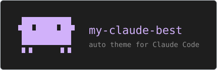

# Auto theme

A light and a dark custom theme for Claude Code, and a hook script that picks the one matching the macOS light or dark mode at each session start.

**Navigation**

- [How it works](#how-it-works)
- [What each file is](#what-each-file-is)
- [What the themes change](#what-the-themes-change)
- [When the theme switches](#when-the-theme-switches)
- [Limits](#limits)
- [Sources](#sources)

Files: [install.md](install.md) (how to set it up, by hand or with one paste) · [custom-light.json](custom-light.json) · [custom-dark.json](custom-dark.json) · [custom-auto.json](custom-auto.json) (the three themes) · [theme-follow-appearance.sh](theme-follow-appearance.sh) (the hook script) · [img/clawd.svg](img/clawd.svg) (the picture)

It is three JSON files, one shell script and two keys in `settings.json`, for macOS. Set it up [by hand](install.md#set-it-up-by-hand) or [with one paste](install.md#install-with-one-paste); to remove it, see [Undo](install.md#undo).

## How it works

Claude Code's own `auto` theme follows the light or dark background of your terminal, but it switches only between the built-in themes. A custom theme cannot point at two other custom themes either: its `base` names a built-in preset only. So the switch happens in a file:

1. `settings.json` selects one custom theme, `custom:custom-auto`.
2. At each session start, the hook script asks macOS whether it is in dark mode, and copies `custom-dark.json` or `custom-light.json` over `custom-auto.json`.
3. Claude Code watches its themes folder and reloads a changed theme file in every open session, so all your sessions change colour together.

## What each file is

| File | What it is | Where it goes |
|---|---|---|
| `custom-light.json` | The light theme, built on the `light` preset. | `~/.claude/themes/` |
| `custom-dark.json` | The dark theme, built on the `dark-ansi` preset. | `~/.claude/themes/` |
| `custom-auto.json` | The theme Claude Code shows: a copy of one of the two above. The script rewrites it, and its name says which one it is: `custom_auto (dark)` or `custom_auto (light)`. | `~/.claude/themes/` |
| `theme-follow-appearance.sh` | The `SessionStart` hook that rewrites `custom-auto.json`. | `~/.claude/hooks/` |

Change your colours in `custom-light.json` and `custom-dark.json`, never in `custom-auto.json`: the script overwrites it. The file name without `.json` is the theme's name in settings, so `custom-auto.json` is `custom:custom-auto`. When `CLAUDE_CONFIG_DIR` is set, the files go to that folder instead of `~/.claude`.

## What the themes change

A theme file has three fields:

| Field | What it means |
|---|---|
| `name` | The label `/theme` shows. |
| `base` | The built-in preset the theme starts from: `dark`, `light`, `dark-daltonized`, `light-daltonized`, `dark-ansi` or `light-ansi`. |
| `overrides` | The colours that differ from the preset. A colour you leave out comes from the preset. |

`dark-ansi` takes almost every colour from the 16 ANSI colours of your terminal, so the dark theme keeps your terminal's palette. `light` uses fixed RGB colours. A colour can be `#rrggbb`, `#rgb`, `rgb(r,g,b)`, `ansi256(n)` or `ansi:<name>`, such as `ansi:magentaBright`. Claude Code ignores a token it does not know and a colour it cannot read, so a wrong name or value never breaks the screen. A file that is not valid JSON is a different case: Claude Code does not load it at all.

| Token | What it colours | Light | Dark |
|---|---|---|---|
| `claude` | The brand accent: the spinner and the `Claude` label | `#C2185B` | `#F4C2C2` |
| `claudeShimmer` | The lighter colour in the spinner's moving gradient | `#E8559A` | `ansi:magentaBright` |
| `briefLabelClaude` | The `Claude` label on Claude's messages | `#C2185B` | `#F4C2C2` |
| `clawd_body` | The body of Clawd, the mascot on the start screen | `#A974E6` | `#D09AF9` |
| `background` | A teal accent on some markers and dialogs | `rgb(0,153,153)` | `rgb(0,204,200)` |
| `userMessageBackground` | The background behind your messages | `#F5EEFC` | `#2a2a2a` |
| `selectionBg` | Text you select with the mouse, in fullscreen mode | `#EAD9FB` | `#3a3a3a` |
| `inactive` | Hints, timestamps and disabled items | `#5E5873` | preset |
| `inactiveShimmer` | The moving gradient on `inactive` text | `#A49EB8` | preset |
| `subtle` | Faint borders and quiet text | `#7E7894` | preset |
| `diffAdded` | Added lines in a diff | `#E6F6EA` | preset |
| `diffRemoved` | Removed lines in a diff | `#FBE7EC` | preset |
| `diffAddedWord` | The changed words inside an added line | `#C6EBD0` | preset |
| `diffRemovedWord` | The changed words inside a removed line | `#F5C9D5` | preset |
| `diffAddedDimmed` | Added lines in the dimmed diff after you reject an edit | `#F1FAF3` | preset |
| `diffRemovedDimmed` | Removed lines in the dimmed diff after you reject an edit | `#FDF1F4` | preset |

`preset` means the theme keeps the colour of its base preset. `/theme` lists every token with a live preview: highlight a custom theme there and press `Ctrl+E` to edit it.

## When the theme switches

| Moment | What happens |
|---|---|
| You start a session, resume one, run `/clear`, compact or fork | The hook runs and `custom-auto.json` follows macOS. |
| macOS switches while a session is open | Nothing yet. Start a new session in any window, or run `/clear`: every open session that uses `custom:custom-auto` then changes too. |
| You edit `custom-light.json` or `custom-dark.json` | `custom-auto.json` gets the change at the next session start, or at once if you run the script by hand. |

Claude Code's built-in `auto` theme follows the terminal at once, but only with the built-in themes. This module trades that for your own colours.

## Limits

- macOS only. The script reads `defaults read -g AppleInterfaceStyle`; without macOS it always picks the light theme.
- It reads the macOS setting, not your terminal's background. Use a terminal profile that follows the system appearance (in Terminal, the Basic profile does); with a fixed white or black profile the theme can disagree with the screen.
- It finds the label to rewrite by a line that starts with `"name":`. Keep `name` on its own line in your two files; without such a line, `custom-auto.json` keeps the source's label.
- When it fails, for example when a theme file is missing, Claude Code shows a "SessionStart:startup hook error" notice with the script's one-line reason, and the session keeps the theme it had.
- The script does not check the JSON: a broken light or dark file is copied as it is. If the theme does not load (Claude Code shows its default dark colours, or `/theme` does not list `custom_auto`), check that each theme file is valid JSON: `python3 -m json.tool ~/.claude/themes/custom-light.json`, then the same for `custom-dark.json` and `custom-auto.json`.
- `background` and `clawd_body` are not in the token list of the Claude Code docs; Claude Code 2.1.301 uses both. If a later version renames one, that colour falls back to the preset and nothing else breaks.

## Sources

- Anthropic, "Configure your terminal for Claude Code": https://code.claude.com/docs/en/terminal-config (the `auto` theme follows the terminal background; custom theme files in `~/.claude/themes/`, the `custom:<slug>` setting, the `name`, `base` and `overrides` fields, the six presets, the colour formats, the token list, unknown tokens ignored, live reload of a changed file)
- Anthropic, "Hooks reference": https://code.claude.com/docs/en/hooks (the `SessionStart` sources startup, resume, clear, compact and fork; a hook with no matcher runs for each; stdout added to Claude's context; stderr after exit 0 never shown; a non-blocking error notice for other exit codes)
- Anthropic, "Settings files and precedence": https://code.claude.com/docs/en/settings (the theme as a user setting; `CLAUDE_CONFIG_DIR` moves the config folder)
- Claude Code 2.1.301, read from the installed program, for what the docs do not list: the `background` and `clawd_body` tokens in every preset, 71 of the 72 `dark-ansi` colours being ANSI colours, and the themes folder inside the folder `CLAUDE_CONFIG_DIR` names.
