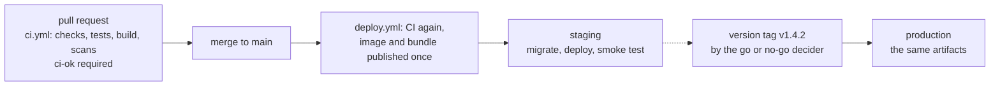

# CI/CD practices

How a team checks every change and ships it: what a CI job is and what goes into it, which event
starts which work, the stages and when they run, the one required check that guards `main`, how
an artifact is built once and promoted to production, how a deploy reaches the cloud without a
stored key, and how the pipeline itself is kept safe, secrets included. The rules hold for any
language and any CI system; the examples are GitHub Actions workflows for a monorepo with a
Python API (uv) and a React application (Vite, pnpm), deployed to AWS.

**Navigation**

- [What is here](#what-is-here)
- [How to adopt](#how-to-adopt)
- [The points to adapt](#the-points-to-adapt)

A plain arrow reads "then"; the dashed arrow is a person's decision.

It is good because each box is the subject of one rules file and one example, and the only
dashed arrow is the decision that [release.md](../project-management/release.md) section 3 gives
to one named person.

## What is here

- [pipeline.md](pipeline.md) — the CI rules: workflow, job, step and runner; CI and CD and how they
  differ; what a job holds and
  what it does not; the triggers and when to use each, automatic or manual; the stages and when
  they run; the gate job as the one required check; a monorepo that runs only what a change
  touches; speed, reproducible runs, a red build and a flaky test. Read it before you write or
  change a CI workflow or the required checks of `main`.
- [delivery.md](delivery.md) — the CD rules: continuous delivery as a pipeline, building once and
  promoting the same artifact, environments and the production gate, OIDC instead of stored keys,
  what a deploy job holds, migrations, smoke tests and the way back, and the deploy targets to
  choose from. Read it before you write or change a deploy workflow or a cloud role it uses.
- [pipeline-security.md](pipeline-security.md) — token permissions, actions pinned by commit,
  untrusted input from pull requests, why a secret never goes into a repository (private ones
  included) and where each secret lives, the security jobs and where they gate a merge and a
  deploy, and review of workflow files. Read it before you add a trigger, a permission, an action
  or a secret to a workflow.
- [ci-example.md](ci-example.md) — `ci.yml` for the monorepo: change detection, the static-checks
  job, backend and frontend jobs, the image job, the call of the security jobs and the `ci-ok`
  gate, plus the root hook file. Read it when you write or change a CI workflow.
- [deploy-example.md](deploy-example.md) — `deploy.yml` and the reusable `deploy-to.yml`: CI on
  `main`, the image and the bundle published once, staging on every merge, production on a version
  tag, the migration, the smoke test, the GitHub environments, and the AWS trust policy and task
  definition. Read it when you write or change a deploy workflow.
- [security-example.md](security-example.md) — `security.yml`, the security jobs that `ci.yml`
  and `deploy.yml` call: workflow linters, a dependency scan of both lockfiles, a secret scan of a
  pull request's commits and CodeQL, plus `CODEOWNERS`, the waiver file and the secret-scanning
  hook. Read it when you set up the security checks.

## How to adopt

1. Copy this folder into your repository at `docs/engineering/any-language/ci-cd/`.
2. Add one line to your `CLAUDE.md` or `AGENTS.md`: "Before you write or change a workflow under
   `.github/workflows/`, a required status check, a deploy job, a cloud role a pipeline uses, or a
   secret a pipeline reads, read `docs/engineering/any-language/ci-cd/README.md` and the file it
   routes to for that work." Without it an agent never opens the folder.
3. The rules and examples link the practices that own a neighbouring rule:
   [release.md](../project-management/release.md) and
   [rollback-plan.md](../project-management/rollback-plan.md) (the release decision, the
   environments, the way back), [images.md](../docker/images.md) (the image job, tags, provenance),
   [static-checks.md](../../python/static-checks/static-checks.md) section 5 (the static-checks job),
   [python/testing](../../python/testing/README.md) (the test suites),
   [security.md](../../react/security/security.md) sections 9 and 10 (the frontend's public values
   and its installs), [libraries.md](../../react/architecture/libraries.md) (the frontend's tools),
   [python.md](../../python/language/python.md) section 5 (how the application reads settings),
   [file-structure.md](../file-structure/file-structure.md) section 9 (`.env.example` and the files
   at the root), and [git.md](../git/git.md) with [ruleset-example.md](../git/ruleset-example.md)
   (pull requests, leaked secrets, the required check, release tags). Copy those practices too, or
   point each link at the rule your project follows instead.
4. Check what your GitHub plan offers before you copy a setting. The plan limits are stated where
   each setting is explained: [delivery.md](delivery.md) sections 4 and 10 (environments, required
   reviewers), [pipeline.md](pipeline.md) section 6 (merge queue), and
   [pipeline-security.md](pipeline-security.md) sections 6 and 7 (push protection, secret
   scanning, CodeQL). On a plan without environments, do not use this deploy.
5. In a repository that already has workflows, apply the rules to new and changed workflows first,
   as [refactoring.md](../refactoring/refactoring.md) section 2 describes. Set a date by which old
   workflows follow three rules: every action pinned by commit, a `permissions:` block on every
   workflow, and no `pull_request_target` workflow that runs a pull request's code. They fix
   security holes, so they do not wait for a change to touch the file
   ([refactoring.md](../refactoring/refactoring.md) section 6).
6. Re-check the lines that name a moving target. Each file's Sources section opens with its
   `Checked <date>` line; the action releases and tool checksums in the examples are dated
   2026-10-18, and so are the plan limits and the preview status of GitHub's workflow lockfiles
   ([pipeline-security.md](pipeline-security.md) section 4).

## The points to adapt

The shape stays: one required gate, every input pinned, the artifact built once, short-lived
credentials, production behind a person's decision, no secret in a repository. Within that shape,
these are your choices; each rules file names the options and their costs.

- Whether pull requests run part of the monorepo or all of it ([pipeline.md](pipeline.md) section 7).
- The deploy target and whether to use GitOps ([delivery.md](delivery.md) section 8).
- The form of the production gate your plan allows: a protected tag, a required reviewer, or both
  ([delivery.md](delivery.md) section 4).
- Whether the frontend bundle can be built once, or must be built per environment
  ([delivery.md](delivery.md) section 3).
- The scanners and the written policy of what fails ([pipeline-security.md](pipeline-security.md)
  section 7).
- The CI system itself: the rules hold on GitLab CI, Jenkins, CircleCI or Buildkite, and the
  examples need rewriting ([pipeline.md](pipeline.md) section 13).
