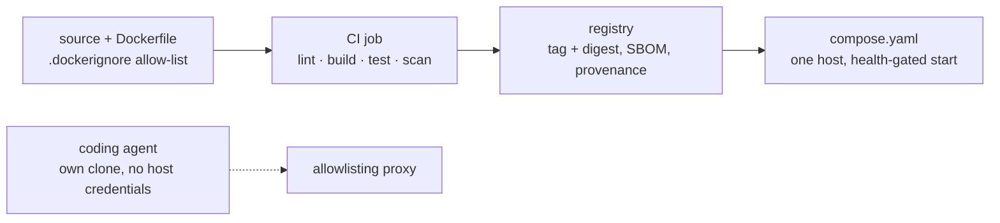

# Docker practices

How a team builds one application's image, from the build context to the registry; how it runs
that image locally with Compose; and how it gives an AI coding agent a container to work in. The
rules hold for any language; the parts written for Python, the language of the examples, are
labelled as the Python case.

**Navigation**

- [What is here](#what-is-here)
- [How to adopt](#how-to-adopt)
- [The points to adapt](#the-points-to-adapt)

A plain arrow reads "is built into" or "runs in"; the dashed arrow is the agent's only way out.

It is good because each box is the subject of one rules file, and the agent's one dashed arrow is
the only way out that [agent-containers.md](agent-containers.md) section 5 leaves it.

## What is here

- [images.md](images.md) — the rules for an image: the build context as an allow-list, stages and
  layer order, the base image and its pins, build secrets, the process at run time, linting, tags
  and labels, SBOM and provenance, the CI job that pushes, and the Python case. Read it before you
  write or change a `Dockerfile`, a `.dockerignore`, or the job that builds and pushes an image.
- [compose.md](compose.md) — the rules for a `compose.yaml`: one reviewed file, health-gated
  start, configuration and secrets, profiles, hardening keys, the trust model, production on one
  host. Read it before you write or change a `compose.yaml`.
- [agent-containers.md](agent-containers.md) — the rules for a container a coding agent works in:
  what it protects, the isolation each level of trust needs, credentials, the network, git, Docker
  inside it, dev containers. Read it before you give an agent a container, a dev container or a
  sandbox, or change one.
- [dockerfile-example.md](dockerfile-example.md) — `pyproject.toml`'s entry point, `.dockerignore`
  and the `Dockerfile` of a Python service built with uv. Read it when you write a service's first
  Dockerfile.
- [compose-example.md](compose-example.md) — the service and its Postgres database in one
  `compose.yaml`. Read it when you write a `compose.yaml`.
- [ci-example.md](ci-example.md) — the GitHub Actions job that builds, tests, scans and pushes the
  image. Read it when you write or change that job.
- [agent-container-example.md](agent-container-example.md) — a `.devcontainer/agent/` definition
  in which Claude Code runs without approvals behind an allowlisting proxy. Read it when you set up
  a container for an agent.

## How to adopt

1. Copy this folder into your repository at `docs/engineering/any-language/docker/`.
2. Add one line to your `CLAUDE.md` or `AGENTS.md`: "Before you write or change a `Dockerfile`, a
   `.dockerignore`, a `compose.yaml`, the CI job that builds or pushes an image, or a container a
   coding agent works in, read `docs/engineering/any-language/docker/README.md` and the file it
   routes to for that work." Without it an agent never opens the folder.
3. The rules and examples link the practices that own a neighbouring rule: [python.md](../../python/language/python.md)
   section 5 (`.env` and settings), [logging.md](../../python/logging/logging.md) section 6 (logs to
   stdout), [file-structure.md](../file-structure/file-structure.md) section 9 (files at the root),
   [git.md](../git/git.md) section 8 (one working tree per session),
   [static-checks.md](../../python/static-checks/static-checks.md) sections 3 (one pinned version
   per tool), 5 (CI is the gate: a check is on or off) and 6 (a suppression names the rule and the
   reason), and [python/testing/libraries.md](../../python/testing/libraries.md) section 2 (testcontainers).
   Copy those practices too, or point each link at the rule your project follows instead.
4. In a repository that already has a Dockerfile, apply the rules to new and changed files first,
   as [refactoring.md](../refactoring/refactoring.md) section 2 describes. The build context and
   build secrets (images.md sections 2 and 5) are about secrets in published images: move those
   by a date, under [refactoring.md](../refactoring/refactoring.md) section 6.
5. Re-check the lines that name a moving target. Most are dated October 2026
   (`grep -rn 'October 2026' docs/engineering/any-language/docker/`); also re-check the version
   floors the rules name: BuildKit, runc, Claude Code 2.1.283 and Docker Engine.

## The points to adapt

The shape stays: every input pinned and moved by a bot, nothing secret in a layer, one non-root
process, a health check where its runtime reads it, an agent that holds nothing it must not leak.
Within that shape, these are your choices; each rules file names the options and their costs.

- The base image (images.md section 4).
- The scanner and its policy, and whether to sign images (images.md sections 9 and 10).
- A read-only root filesystem, and compiling bytecode at build time (images.md sections 6 and 11).
- The isolation for each agent setup, and where the agent's integration tests run
  (agent-containers.md sections 3 and 8).
