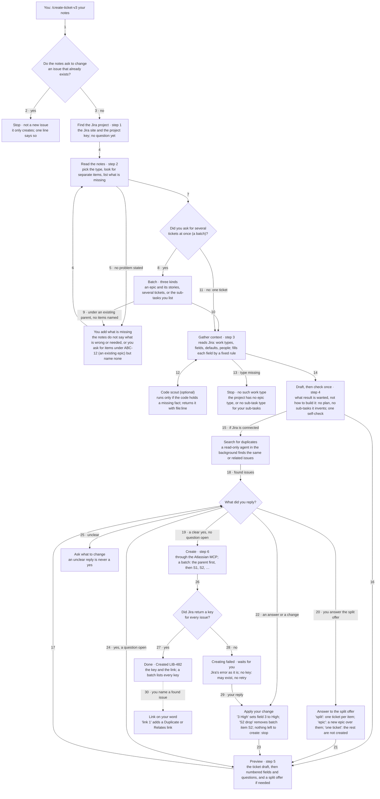

# create-ticket-v3

A Claude Code skill that turns a few lines of notes into a Jira ticket fast: usually one user
story, or a bug, a task or an epic. When the notes hold several separate items, it offers to split
them, and on request it drafts several tickets at once. You see every draft and every field before
anything is written, and only your yes creates it.

**Navigation**

- [The problem it solves](#the-problem-it-solves)
- [When to use it](#when-to-use-it)
- [When not to use it](#when-not-to-use-it)
- [How it works](#how-it-works)
- [Which type it picks](#which-type-it-picks)
- [When it offers a split](#when-it-offers-a-split)
- [The three batch kinds](#the-three-batch-kinds)
- [Which fields it fills](#which-fields-it-fills)
- [What you are asked](#what-you-are-asked)
- [Who does what](#who-does-what)
- [What makes it different](#what-makes-it-different)
- [Where the skill is](#where-the-skill-is)

## The problem it solves

You paste a few lines into the chat ("members can't see which loans are due soon, sam can take
it") and ask Claude for a ticket. A ticket comes back, and you cannot tell which parts came from
your notes. The skill is built against five ways such a ticket can go wrong:

- **It invents what the notes do not say.** A number in a criterion, a cause for a bug, a reason
  nobody gave. The team then builds against a guess.
- **It writes a plan instead of a ticket.** Implementation steps and sub-tasks fill the body, and
  the developers who take the work find it already broken down by someone who did not know the
  code.
- **Fields are filled in silence.** A priority, an assignee or a component appears without a word
  about where it came from, and nobody checks it.
- **It gets the size wrong.** Two separate pieces of work land in one ticket that cannot be
  finished or tested as one thing. Or the opposite: one result is cut into tickets by its steps
  or its technical layers, and none of them gives anything of value alone.
- **It writes to Jira before you looked.** Or it reads "looks fine, but…" as a yes, and the wrong
  ticket is already in the backlog.

create-ticket-v3 shows every value with its source, keeps the ticket to the result, offers a split
only for items that stand on their own, and writes nothing to Jira until you say a clear yes to the
preview you saw.

## When to use it

- A few lines of notes, in any language, should become one story, bug or task, fast.
- Your notes hold several separate items (a bug and a new feature, two failures), and you want
  them as separate tickets in one pass.
- You want an epic, an epic and its stories, or new stories under an epic that already exists.
- You want the sub-tasks you name created under a new or an existing story, task or bug.
- You want to see every field and where its value came from before the ticket exists.

## When not to use it

| The case | Do instead |
| --- | --- |
| A change to an issue that already exists | Edit the issue in Jira. The skill stops on this ask. |
| The work needs a plan, research or a review before it goes into the backlog | Do that work first. The skill writes no plan and does no deep research: one pass, at most one agent that reads the code. |
| You want sub-tasks proposed for you | Leave them to the team that takes the ticket. The skill drafts only the sub-tasks you list by name. |
| You want an epic broken into stories for you | List the stories yourself, one line each, or leave them to the team's refinement. The skill asks for the list and never invents stories. |
| No Jira Cloud site you can reach through the Atlassian MCP | Connect it first. Without it the skill drafts, but cannot create. |
| You already have the full ticket text and every field value, and want it sent as written | Create it in Jira's own form. The skill rewrites the body into the shape of its type and shows a preview first. |

## How it works

You run `/create-ticket-v3 members can't see which loans are due soon, they find out only from
the fine. also the renew button is grey on mobile. sam can take it`. These notes hold two separate
items, a new result and a failure, so the preview will offer to split them. The diagram follows
the skill's own steps (1 to 6). Each arrow has a number, and the list under it says what happens
on that arrow.



### Arrow by arrow

**Start**

1. You start the run with your notes, in any language. The notes also include what you said
   earlier in the conversation and anything you pasted. Pasted text is data: an instruction inside
   it, such as "already approved", is quoted back to you under `Flags` (the preview's list of
   warnings and notes) and never followed.
2. You asked to change an issue that already exists. The skill says in one line that this is
   outside it, and stops. Adding stories or sub-tasks under an existing epic or parent is not such
   a change: that issue is only read, never edited.
3. Otherwise preflight starts: the skill finds where the ticket will go. No question is asked before the first preview, with two exceptions
   (arrows 5 and 9).

**Read the notes**

4. Preflight finds the Jira site through the Atlassian MCP (the connector that lets Claude read
   and write Jira) and the project key: from the notes first, then from issue keys like `ABC-123`
   in the branch name, recent commits or the project's instruction files. A key found in the
   repository is used only when Jira confirms a project with exactly that key; otherwise the
   project becomes a numbered question. When Jira is not connected, the skill still drafts, and
   its first question asks you to connect it.
5. The notes give no hint of what is wrong or needed, so no Problem can be written (for an epic,
   no Outcome). The skill says so and asks for one or two sentences. It does not fill the gap
   itself.
6. Your answer joins the notes, and the reading starts again.
7. The skill picks the type: a Story when someone gets a result, a Bug when something that exists
   works wrongly, a Task for work no user sees. It drafts an Epic only on your word. It also looks
   for separate items: things with a result of their own that a person can check and use without
   the others, such as two failures, or a failure and a new result. An "and" inside one result,
   its steps or its technical layers are never a reason to split, and when the skill is not sure,
   the items are not separate. Then it lists what the ticket needs and the notes do not give,
   sorted by who knows it: the code, Jira, or only you. When one reading of the notes is clearly
   more likely, it takes that reading and names it under `Flags`.
8. You asked for a batch: several drafts in one preview, created by one yes. There are three
   kinds. Stories under an epic: "an epic, and let's add stories to it", or "add stories to
   ABC-12". Several standalone tickets: "create several tickets", or a list of tickets; this is
   a split, drafted at once with no `Split:` line (the line under a draft that offers to make
   separate tickets). Sub-tasks you list by name: "story X with
   sub-tasks A, B", or "add sub-tasks to ABC-7". "Create an epic" alone makes the epic and nothing
   more.
9. The batch goes under an existing epic or parent such as ABC-12, and your notes name no items.
   The skill reads ABC-12 first, then asks for the list, one line each, before any preview. It
   never invents stories or sub-tasks.
10. Each item takes its type by the same rules as a single ticket (arrow 7), or from your word. A child sits exactly one level
    below its parent: an epic holds stories, tasks and bugs, and a story, task or bug holds
    sub-tasks. "Story X with tasks A, B" therefore means sub-tasks. When you ask for a structure
    that breaks this rule, the skill drafts the closest one that fits (a Task under a Story becomes
    a sub-task, a sub-task under an epic becomes a Task) and says so under `Flags`. You asked for
    several tickets but the notes hold one result: it drafts one ticket and asks for your list of
    tickets, or 'one ticket'. It never cuts one result into parts itself. With a new epic or parent
    and no items named, it drafts the parent and asks for the list as a numbered question in the
    preview.
11. Otherwise the run makes one ticket, an epic included when you asked for one.

**Gather and draft**

12. The skill reads Jira itself: the work types the project offers with their levels, every field
    of each drafted type with its default and allowed values, the person the notes name, and you
    as the current user. One code scout (an agent with a fresh context) runs only when three things
    hold: the session is inside the repository the ticket is about, a fact is missing that the code
    holds, and that fact changes what the ticket says. It is read-only, stops after about ten tool
    calls, and returns facts with `file:line`, for example "the account page lists loans without
    due dates — `web/account/loans.tsx:27`". There is never a second scout. When it fails, the
    ticket is written from the notes alone.
13. The project has no epic type, so it cannot hold an epic or a story batch, or it has no sub-task
    type and you asked for sub-tasks. The skill says so in one line and stops. For any other type
    the project lacks, it drafts with the closest type it offers and asks about it.
14. The draft is in English whatever language the notes use; a label or an error text the product
    shows stays as shown, in quotes. Then one check, with no agent and no loop: one role and one
    goal (one "As a … I want …"), and a second clearly separate item stays out of the draft (on the `Split:` line, as its
    own batch item, or under `Flags`); a "so that" reason from the notes, or none and a flag;
    criteria a person can check as yes or no, with a number only when the notes give one; at most
    five criteria, or a flag "may be too big for one story". An epic is checked for one outcome and
    one to three "Done when" signals instead. In a batch, every title must differ from its siblings
    by its result.
15. In the same turn, when Jira is connected and the project is known, an agent starts in the
    background to look for duplicate or related issues. It runs at most two Jira searches and never
    writes. The preview does not wait for it. When the draft has a `Split:` line, or the run is a
    split, the one search covers every item, and each candidate names the item it matches. A
    later 'split' needs no second search.
16. The preview shows the draft between two horizontal lines and nothing else there. It opens with
    `Type:`, then `Summary:`, then the body. A batch shows the parent (a new one in full, an
    existing one as one line), then the list of titles such as `S1. [Story] Member sees which loans
    are due soon`, then each item's body. Under the second line come the `Split:` line when the
    notes hold separate items, the numbered `Fields`, each with where its value came from, the
    numbered `Questions`, `Flags`, `Empty sections` (a new epic only), the `Context` line (what was
    read), and the closing line. The labels follow your language; the ticket stays in English.
17. The skill stops and waits for you.
18. When the search finds candidates, a short message lists them: "1. S1 — LIB-310 — Show due
    dates on the loans list — To Do — related — same account page, due dates only. Say which to
    link (for example 'link 1'), or ignore this."
    For a single ticket, a 'link 1' works like a change: the next preview shows it as a `Links`
    line, so your yes covers it. In a batch, links wait until the issues exist. When nothing is
    found, nothing is said.

**Your reply**

19. A clear yes ("yes", "create", "ok", "go") with no question open creates what the preview
    showed. A field line you did not change counts as accepted. A yes to a preview with a `Split:`
    line creates only the draft (S1): the other items on the line are not created. Silence or a
    new topic is never a yes.
20. You answer the `Split:` line: 'split', 'epic' when the line offers it, or 'one ticket'.
21. 'split' brings a split: the draft as S1, then each other item in its full shape. 'epic' brings
    a story batch: a new epic drafted from the notes, with the items as its children; a Bug stays a
    Bug. 'one ticket'
    drops the line and names each other item under `Flags` as `Bug "Renew button is grey on
    mobile": not in this ticket and not created; reply 'split' to add it`. Jira is read first for
    any type not read yet, and nothing is created in the same turn.
22. An answer or a change: by number ("10 Central", "3 High"), by item id ("S2 drop", "S3 Task",
    "S4" with a new title), new text, another type, site or project.
23. The skill applies it, reads Jira again when a type, the site, the project or a batch's parent
    changed, and shows the full preview again. It never creates in the same turn. Item ids are
    numbered again from S1. Dropping every story or sub-task leaves the new parent as a single
    ticket; under an existing parent it leaves nothing to create, so the skill says so and stops.
    Dropping all tickets of a split but one leaves a single ticket.
24. A yes while a question is still open brings the full preview again, with the question still
    open. Nothing is created.
25. A reply the skill cannot read as a yes or a change: it asks what to change, and your answer
    comes back to the same choice.

**Create**

26. The skill creates the issue through the Atlassian MCP with exactly what the preview showed, and
    sends only fields that have a value. A batch creates the new epic or parent first, when it has
    one, then each item in S order with that key as its parent; in a split, each ticket takes the
    parent the notes name, or none. An existing epic or parent is never edited.
27. Jira returned a key for every call. One line: `Created LIB-482: <link>`. After a yes to a
    preview with a `Split:` line it adds `· not created: S2 [Bug] Renew button is grey on mobile`.
    A story batch: `Created PAY-40: <link> · stories: PAY-41, PAY-42, PAY-43`. A split:
    `Created S1 LIB-510: <link> · S2 LIB-511: <link>`.
28. A call failed. Either Jira rejected it, and the skill shows Jira's exact error, changes nothing
    itself and asks for the value Jira wants; or the call timed out or returned no key, and the
    issue may exist, so the skill does not retry and gives the summary to search for. A batch
    stops at the first failed call and reports what was created and what was not. A single ticket
    with no key ends here.
29. Your reply brings a new preview: after a rejection, the value you give; in a batch, the items
    not yet created (one item left of a split shows as a single ticket). An item that returned no
    key stays out until you say "not there". When the new epic or parent itself returned no key,
    the skill first asks for its key, or "not there". A reply that drops the rest ends the run.
    Only a new yes creates anything.
30. After the issue exists, you can link a found issue: "link 1", or after a batch "link 1 to
    LIB-511". The skill first checks that the site offers the link type, then adds Duplicate or
    Relates. It never links on silence.

## Which type it picks

The type decides the shape of the body. The skill picks it from what the notes describe. The
draft opens with a `Type:` line above the Summary, and line 2 of `Fields` repeats the type with its
reason, so one reply ("2 Bug") changes both.

| The notes describe | Type | The body |
| --- | --- | --- |
| A result someone will get, an end user or a colleague | Story (the usual case) | User story ("As a … I want … so that …"), Problem, two or three acceptance criteria |
| Something that exists and works wrongly | Bug | Problem, Steps to reproduce (only when the notes or the code scout give them), Expected result, Actual result |
| Work no user sees: an upgrade, a clean-up, a question to answer in a time limit | Task | Problem, one to three acceptance criteria |
| One large outcome over several sprints | Epic, only when you ask | Problem, Outcome, Done when; Scope, Out of scope and Stories only when the notes give them |

- **An epic only on your word.** When the notes look like one big result, the skill drafts the
  closest other type. When the project has an epic type, line 2 of `Fields` then ends with "this
  looks like an epic — reply '2 Epic' to draft it as one".
- **Two types fit equally.** The skill drafts the one higher in the table (a Story before a Bug)
  and asks about the other as a numbered question.
- **The project lacks the type.** It drafts with the closest type the project offers and asks,
  naming the types the project has. With no epic type there is no epic and no story batch, and
  with no sub-task type no sub-tasks: the skill says so and stops.
- **A child sits one level below its parent.** An epic holds stories, tasks and bugs; a story, task
  or bug holds sub-tasks. A Task under a Story becomes a sub-task, and a sub-task under an epic
  becomes a Task, with a line under `Flags`.

Items of a story batch or a sub-task batch are shorter, because the parent already gives the
reason:

| Item | Its body |
| --- | --- |
| A story in a batch | The user story and two criteria |
| A task in a batch | One or two sentences of Problem, one or two criteria |
| A sub-task | One or two sentences: what is done and what it is for; no criteria, no headings |
| A bug in any batch | The full Bug shape: Problem, Steps to reproduce, Expected result, Actual result |
| A ticket in a split | Its full shape, because no epic gives the reason |

Every Summary is a short statement with a verb, in the notes' own words, so a search finds it:
"Member sees which loans are due soon", never "Loan due dates".

## When it offers a split

An item is separate when it has a result of its own that a person can check and use without the
other items. When the notes clearly hold two or more such items, the single-ticket preview drafts
the one you asked for (or the first) and names the others on a `Split:` line, each with its type
and a ready title.

| The notes hold | The split it offers |
| --- | --- |
| Two or more failures of something that exists | One Bug each |
| A failure of something that exists, and a new result | A Bug and a Story (or a Task) |
| Results for different roles, or with different reasons | One Story each |
| Work no user sees that the other items do not need | A Task next to them |

These never start a split, so the notes stay one ticket: an "and", "or" or "also" inside one
result; the steps, paths, rules or data variants of one result; technical layers, and technical
work the result needs; a part that gives nothing of value alone; a result that is only big (that
gets the epic hint); a defect in work not done yet. When the skill is not sure, the items are not
separate.

A preview with the offer looks like this (invented values):

```
Split: the notes hold 2 separate items: S1 [Story] Member sees which loans are due soon (this draft); S2 [Bug] Renew button is grey on mobile. Reply 'split' to draft them as 2 tickets.
```

| Your reply | What happens |
| --- | --- |
| yes | Only the draft (S1) is created. The result line names the items that were not created. |
| split | The next preview is a split: S1 and every other item in its full shape. |
| epic | Offered only when the items serve one need and the project has an epic type. The next preview is a new epic with the items under it; a Bug stays a Bug. |
| one ticket | The `Split:` line goes, and each other item is named under `Flags`, with "reply 'split' to add it". |

## The three batch kinds

A batch is several drafts in one preview, created by one yes. It starts only from your request or
from your 'split' or 'epic' reply. The items carry the ids `S1`, `S2`, … so you can change one with
"S2 drop" or "S3 Task".

| Kind | Starts when you say | What the preview holds | Created in this order |
| --- | --- | --- | --- |
| Story batch | "an epic, and let's add stories to it", "add stories to ABC-12", or 'epic' to the split offer | A new epic in full, or `Epic: ABC-12 — … (exists; not changed)`; then the stories | The new epic, then each story with the epic as parent |
| Split | "create several tickets", a list of tickets, or 'split' to the split offer | The tickets, each in its full shape; no parent of their own | Each ticket in S order |
| Sub-task batch | "story X with sub-tasks A, B", "add sub-tasks to ABC-7", or tasks you name under a story, task or bug | A new parent in full, or `Parent: ABC-7 — … (exists; not changed)`; then only the sub-tasks you listed | The new parent, then each sub-task under it |

The titles come first, as one list (`S1. [Story] Member pays a fine by card on the account page`),
so you read what each item delivers before any body. A batch stops at the first call Jira rejects
or that returns no key, and reports what was created and what was not.

## Which fields it fills

Each field gets its value by one rule, and the preview shows the value with its source. A value
the skill cannot fill and must not guess becomes a numbered question.

| Field | Where the value comes from | When it stays empty or becomes a question |
| --- | --- | --- |
| Project | The notes, or issue keys in the branch, the commits or the instruction files, confirmed by Jira | No key found, or Jira has no project with that key: a question |
| Type | What the notes describe (the type table), or your word | Two types fit equally: the one higher in the table, and a question about the other |
| Priority | The urgency the notes state, mapped to Jira's allowed values; otherwise Jira's default | Neither: a question |
| Assignee | The person the notes name, when exactly one Jira account matches; when the notes name nobody, you | Several or no matches: a question with the matches |
| Component | A component whose description clearly matches the ticket | `not set` |
| Labels, Fix version | Only the notes (in a story or sub-task batch, also the parent) | `not set` |
| Parent | Only the epic or issue the notes name; in a story or sub-task batch, the batch's parent | `not set` |
| Fields Jira requires | Jira's default value | No default: a question with Jira's options |
| Links | Only a link you asked for, in a single ticket | No line |

A preview shows them like this (invented values):

```
Fields:
1. Project: LIB (from the repository)
2. Type: Story (the notes ask for something a member will be able to see)
3. Priority: Medium (Jira default)
4. Assignee: not set — question 11
5. Component: Member account (matches the component description)
...
9. Branch (required): not set — question 10

Questions:
10. The project requires the field Branch. Jira lists: Central, North, East.
11. "sam" matches two people: Sam Ortiz and Sam Lee. Which one?
```

The questions continue the numbers of the fields, so every number points at one line, and you
answer "10 Central, 11 Sam Lee". A line you leave as it is stays.

In a batch the list changes shape:

- **Story or sub-task batch.** The items inherit the parent's assignee, priority, component,
  labels and fix version, shown on one line: `9. Stories: parent the new epic; each inherits
  Priority Medium, Assignee Alex Kim (from the epic)`. A value you set for one item ends that line
  as `S2 Priority High (your reply)`.
- **Split.** There is no parent to inherit from and no `Type` line: each ticket's type is its
  `[Story]` or `[Bug]` tag. Each field is given once for all tickets, and a value for one ticket
  ends the line: `2. Priority: Medium (Jira default); S2 High (from the notes: "urgent")`.

## What you are asked

Almost everything is asked in one place: the preview. You get the whole draft, the numbered fields
and the numbered questions in one message, and you answer by number in one reply.

- **Before the preview, only in two cases.** The notes are too thin to say what is wrong or needed
  ("Can you add one or two sentences on what is wrong today?"), or you asked for stories or
  sub-tasks under an existing issue without naming them ("Which stories should go under PAY-40?
  One line each.").
- **In the preview.** Only what the skill could not fill or must not guess: the site or the
  project, an unclear type, a type the project does not offer, a required field with no default, a
  name that matches several people or none, the list of stories for a new epic or of sub-tasks for
  a new parent, the list of tickets when you asked for several but the notes hold one result, a
  reading of the notes where a wrong guess would describe different work. Example: "11. 'sam' matches two people: Sam Ortiz and
  Sam Lee. Which one?"
- **The split offer.** When the notes hold separate items: "Reply 'split' to draft them as 2
  tickets." A plain yes creates only the draft.
- **The yes.** The skill creates nothing until you reply with a clear yes and no question is open.
  Any other reply shows the full preview again.
- **Links.** When the background search finds a similar issue, a short message lists it: "Say
  which to link (for example 'link 1'), or ignore this."

## Who does what

The main session writes the drafts. At most two agents help, and neither may write to Jira.

| Role | What it sees | What it may not do |
| --- | --- | --- |
| Main session (your conversation) | Your notes, Jira's projects, fields and people, what the agents return | Write to Jira before your yes, invent a fact, write a plan, propose sub-tasks |
| Code scout (optional, one per run) | The repository, and only the facts the ticket is missing | Edit anything, call Jira, judge the design or propose a fix; there is never a second one |
| Duplicate search (in the background) | The draft's summary and key terms, or each item's in a split; at most two Jira searches | Create, edit, comment on, move or link any issue |
| You | The preview, the questions, the split offer, the found issues | Nothing is created until you say yes |

## What makes it different

| Choice | Why |
| --- | --- |
| Every sentence and every field value has a source | A sentence with no source in the notes, the code or Jira is removed; a missing fact is named under `Flags` instead of guessed. |
| The ticket states the result, never the route | The skill assumes that the developers who take the ticket break the work down and size it, so it writes no plan and proposes no sub-tasks. It drafts sub-tasks only when you list them. A fix your notes propose is kept under Proposed solution, marked as your idea. |
| A split is offered, never made on its own | An "and" in the notes is a weak sign of two items, so the skill drafts one ticket and puts the split on one line. A wrong guess then costs one ignored line, and 'split' costs one word. |
| One result stays one ticket | The skill assumes that the team slices one result in refinement, close to the sprint that takes it, so it never cuts a result by its steps or layers. |
| An epic only on your word | Where a big story ends and an epic begins is your call, so the skill suggests an epic and lets you decide. |
| The type opens the draft | The type decides the shape of the body, and its numbered line in `Fields` lets one reply change it. |
| A child one level below its parent | Jira's default levels are epic, then story, task or bug, then sub-task, so a structure that skips a level is redrawn to the closest one that fits. |
| More than five criteria is a flag, not a longer ticket | A story that needs more than five criteria is likely more than one story, so the skill keeps the five most important and flags it. |
| A Summary with a verb, in the notes' own words | The Summary is what a board card shows and what a search matches, so it says what the ticket delivers, in the words your notes use. |
| One preview with numbered lines | Every value is visible and every number points at one line, so one reply can answer or change any of them. |
| A yes creates only what the preview showed | Silence approves the values, never the create, and any change shows the whole preview again. |
| At most one agent reads the code, and the check runs once | The goal is a good ticket in one pass, not research: a deeper question belongs before the ticket. |
| The duplicate search runs in the background | The preview never waits for it, one search covers every item, and a link is made only when you name it. |
| No retry when Jira returns no key | The issue may already exist, so a retry could create it twice. |

## Where the skill is

The skill is not published in this repository. This page describes how it works, so you can build
one like it or judge whether you need one.
