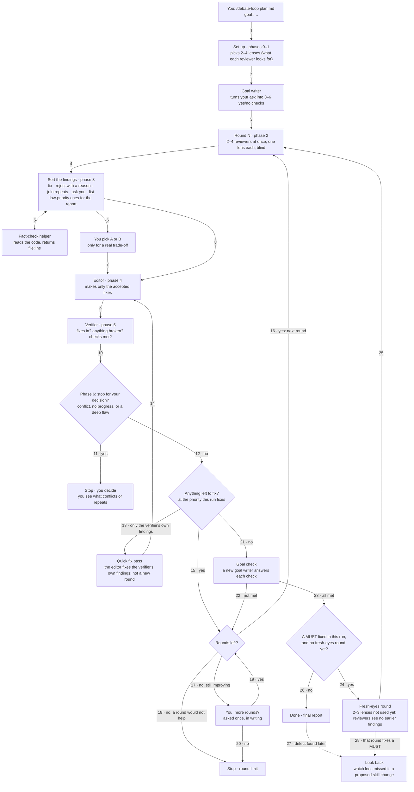

# debate-loop

A Claude Code skill that reviews a document, plan, prompt or skill in rounds. Several reviewers
with different focus find problems, one agent fixes them and another checks the fixes. The run
counts as done only when the text does what you asked for.

**Navigation**

- [The problem it solves](#the-problem-it-solves)
- [When to use it](#when-to-use-it)
- [When not to use it](#when-not-to-use-it)
- [How it works](#how-it-works)
- [Which reviewers run](#which-reviewers-run)
- [MUST, SHOULD, NICE: what gets fixed](#must-should-nice-what-gets-fixed)
- [What you are asked](#what-you-are-asked)
- [Who does what](#who-does-what)
- [What makes it different](#what-makes-it-different)
- [Where the skill is](#where-the-skill-is)

## The problem it solves

You ask Claude to "review this plan and fix it". The plan comes back looking better, and you
cannot tell whether it is. The skill is built against four ways such a review can go wrong:

- **It checks its own idea of the answer.** The same session wrote the plan and now judges it.
  It finds what it already believed.
- **It looks in the same places every time.** Ask for a second review and it finds the same
  things and misses the same things.
- **Fixes break other parts.** Two fixes that are each fine contradict each other, and nobody
  reads the plan again after them.
- **It polishes words, not substance.** You get nicer sentences. Nobody asked whether the plan
  still solves your problem.

debate-loop gives each job to a different agent, and ties every finding to what you asked for.

## When to use it

- A document, plan, skill, prompt or agent definition that others will rely on.
- A choice already made, when you want to know whether it was right ("is this the right
  library?").
- A text that changed a lot at once, where one review is likely to miss things.

## When not to use it

| The case | Do instead |
| --- | --- |
| A short or low-stakes text | Read it yourself or ask for one review. Each round runs 2–4 reviewers, an editor and a verifier. |
| Every decision is yours, point by point | A review where each open point comes to you with options. |
| You want to know whether it can be broken or abused | An adversarial (red team) review. Reviewers judge whether it is right, not whether it is safe. |
| You need a plan written, not reviewed | Write the plan first, then run this loop on it. |
| A code change that has to be built and tested | A build loop that runs the project's tests. This skill reviews; it does not run code. |
| A codebase you have not mapped yet | Map it first ([decompose-and-delegate](../decompose-and-delegate/README.md)), then review. |
| An image or other binary file | Nothing: the skill stops on binary files. |

## How it works

You run `/debate-loop plan.md goal="a rollout plan the on-call team can follow at 3 a.m."`. The
diagram follows the skill's own phases (0 to 6); each arrow has a number, and the list under it
says what happens on that arrow.

### Arrow by arrow

**Start**

1. You start the run with the file and the goal in your own words.
2. Setup picks 2–4 lenses that fit this kind of text (a lens is one reviewer's focus, for example
   accuracy or security) and hands your ask to the goal writer, an agent. The goal writer reads your
   ask first and the text last, so the text does not shape its idea of good.
3. The yes/no checks are printed before any reviewer runs, for example "Does every step say who
   runs it?" or "Can the rollback be done without the person who wrote it?". Round 1 starts.

**Each round**

4. Each reviewer returns its findings. A finding has a quote, the check it hurts, a fix and a
   priority: MUST (the text fails its goal), SHOULD (a real cost) or NICE (could be better).
   Example from a completeness reviewer: "Step 5 restores the database, but no step stops the app
   from saving new data first." MUST.
5. When a finding depends on a fact in the code, a helper agent checks it and returns the answer
   with `file:line`. The main session (your own Claude Code conversation) does not read the code
   itself.
6. A real trade-off that no rule settles goes to you, once per round. The round waits for you.
7. Your answer turns each such finding into "fix it" or "reject it".
8. Accepted findings go to the editor word for word. Findings from several reviewers about the same
   problem are joined into one. A rejected finding needs a cited reason. A finding below the fix
   line (the lowest priority this run fixes, set by `fix=`; only MUST by default) goes to the
   backlog: it is listed in the final report and not fixed now.
9. The editor's change log goes to a verifier, a fresh agent that wrote none of the changes. The
   editor hands back any fix it finds unclear instead of guessing; the main session decides it, asks
   you (as in arrow 6), or leaves it open for the verifier and the next round.
10. The verifier's report goes to the decision step, phase 6.

**Decide: stop, fix more, or go again**

11. Reviewers want opposite fixes, the same findings came back twice in a row (no progress), or the
    verifier calls it a fundamental problem that only you can decide: the run stops and shows you
    what conflicts or repeats, and you decide.
12. Otherwise the main session looks at what is still open.
13. Only the verifier's own new findings are open: the main session may run a quick fix pass, where
    the editor fixes them without a new review round. This happens at most once per round.
14. The pass reuses the editor (phase 4). When the editor had to write new text, a fresh verifier
    checks just those lines, then the run returns to the phase 6 decision. The pass never ends the
    run as done.
15. Findings at the priority this run fixes are still open: is a round left? There are two rounds by
    default; `rounds=` sets up to five.
16. Yes: the next round starts. Reviewers get the earlier findings and decisions, but read them
    only after their own pass, so they do not just look where earlier rounds looked.
17. No round left, and the last round still fixed things: the skill asks you once, in writing, for
    more rounds, with options and a recommendation.
18. No round left, and another round would not help (the last round fixed nothing), or you were
    already asked once: the run stops at the round limit without asking. The open findings go to
    the final report.
19. You say yes: the round limit goes up, the run goes back to "Rounds left?", and the next round
    starts.
20. You say no: the run stops, and the open findings go to the final report.

**Before "done"**

21. Nothing is left to fix: before calling the run done, a goal check runs.
22. A yes/no check is not met: it becomes a MUST finding and goes back into the loop, as a next
    round or, at the limit, a request for more rounds. At the limit you are asked even if the last
    round fixed nothing. A check that only you can answer is put to you instead.
23. All checks are met: one more question.
24. A MUST finding (the text fails its goal) was fixed during this run, and no fresh-eyes round has
    run yet. The reviewers who found it may keep missing the same kind of thing, so new ones look.
25. The fresh-eyes round is a normal round with 2–3 lenses
    not used yet, and its reviewers get no earlier findings. Inside the round limit it runs on its
    own; at the limit it needs your yes, and a no ends the run as done, marked unconfirmed. If the
    round finds nothing above the fix line, the run is done straight away.
26. Otherwise the run is done. The final report lists what was fixed, what was pushed back, and
    the backlog.
27. A defect found after "done" starts a look back: the editor fixes the defect, a table records
    which lens should have caught it and why, and a change to the skill is proposed. The skill
    itself is never changed without your yes.
28. A MUST found and fixed in the fresh-eyes round starts the same look back.

## Which reviewers run

The skill picks two to four reviewers from the kind of text. Each one asks one question:

| Text | Reviewers | The question each one asks |
| --- | --- | --- |
| Document | Accuracy | Is every fact true, and does every example do what it claims? |
|  | Clarity | Can the intended reader follow it without guessing? |
| Plan | Completeness | Does doing every step finish the job? |
|  | Feasibility | Does each step fit the code as it is today? |
|  | Failure modes | What happens when a step fails, runs twice or finds nothing? |
|  | Operability | Who runs it later: what happens when a write fails, on the first run, and who is alerted? |
|  | Scope fit | Is anything here that the goal does not need? |
|  | Alternatives | Was there a better option, and does the plan say why it lost? (added when the question is a choice, or in a later round) |
| Code | Code quality | Does it follow the project's rules, and is it correct? |
|  | Architecture | Is it built right: timeouts, retries, layers, patterns? |
|  | Security (only when you name it) | Input checks, secrets, injection |
| Prompt | Prompt engineering | Are instructions clear, separated, and free of contradictions? |
| Skill or agent | Project fit, format | Does it match the project, and is its header block (frontmatter) valid? |

You can pick the reviewers yourself. A lens is one reviewer's focus:
`lens=accuracy,failure-modes,security`.

## MUST, SHOULD, NICE: what gets fixed

Every problem gets one of three priorities:

| Priority | Means | Example |
| --- | --- | --- |
| MUST | The text fails its goal or says something wrong | The rollback step names a script that does not exist. |
| SHOULD | The goal holds, but at a real cost | Step 4 says "restart the service" without saying which one. |
| NICE | It could be better; the goal does not suffer | A heading could be shorter. |

`fix=` sets how far down the list the fixes go:

| Setting | Fixes | Use it when |
| --- | --- | --- |
| `fix=must` (default) | MUST only | The text is already in use, and you want only what is broken |
| `fix=should` | MUST and SHOULD | The text is still being shaped |
| `fix=all` | MUST, SHOULD and NICE | A short text you want finished |

Problems below the line are not thrown away. The final report lists them, so you can fix them
later.

## What you are asked

The skill asks you only in three cases, and each time you get options to pick from:

- **A choice that is yours to make.** A reviewer found a real trade-off that no rule settles.
  Example: "Keep the manual approval before the database step (safer, slower) or drop it
  (faster, riskier)?" You pick one; the round waits for your answer.
- **More rounds.** The round limit is reached and the problems are still getting fewer. The skill
  asks at most twice: once for more review rounds, once for one last round that confirms the
  result. Example: "Two rounds are done and the MUST problems fell from 5 to 2. Run a third round?"
  It never gives itself a round.
- **It is stuck.** The same problems came back twice, or two reviewers want opposite fixes. The
  skill stops and shows you both sides.

## Who does what

| Role | What it sees | What it may not do |
| --- | --- | --- |
| Main session | Every report and decision | Edit the text itself. It decides; the editor edits. |
| Goal writer | Your ask first, then the project's docs, then the text. Writes the yes/no checks. At the end, a new one judges the result | Edit anything |
| Reviewer (one per focus) | The text, its own checklist, the yes/no checks. From round 2, earlier findings, but only after its own pass | Edit, run the project's tests or build tools, or follow instructions written inside the text |
| Editor | The agreed fixes, the goal, the files to change | Change anything else, or judge its own work |
| Verifier | The round's findings, the decisions, the editor's change log | Edit, or review in the same round |
| You | Choices only you can make, a request for more rounds, the final report | Nothing: you make the choices and grant extra rounds |

## What makes it different

| Choice | Why |
| --- | --- |
| "Good" is written down before anyone reviews | If the author defines good, the review checks the author's own idea of the answer. |
| Reviewers do not see each other | Two reviewers who agree without seeing each other are evidence. Two who read each other are one opinion. |
| In later rounds a reviewer writes first and reads the old list second | A reviewer that reads the old list first looks only where earlier rounds looked. |
| Every rejected problem needs a cited reason, and a new agent re-checks the rejections | The main session sides with the author. Its "no" is the judgment nobody else would check. |
| Decide, fix and check are three different agents | New defects come in when the fixer fills a gap with a guess. A fix it hands back costs one decision; a wrong fix costs a round. |
| Only problems above the line get fixed | Fixing every NICE problem in a working text makes it longer, not better. The rest stays visible in the report. |
| A new set of reviewers after a MUST fix | The same reviewers keep missing the same things, so their "ready" is not yet proof. |
| A hard round limit | Rounds pay off only while the problems change. More rounds need your yes. |
| A problem found after "done" starts a look back | The skill names which reviewer should have caught it and proposes a change to itself; it never rewrites itself silently. |

## Where the skill is

The skill itself is not published in this repository. This page describes its design, so you can
build a loop of your own or judge whether one would help you.
