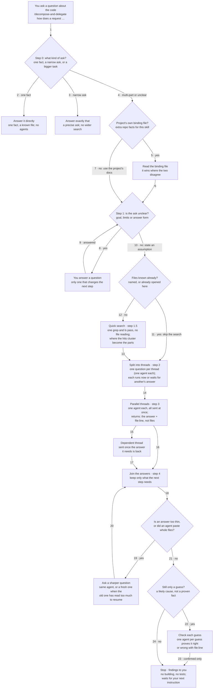

# decompose-and-delegate

A Claude Code skill that splits a big question about the code into small questions, gives each
one to its own agent, and keeps only their answers in your conversation.

**Navigation**

- [The problem it solves](#the-problem-it-solves)
- [When to use it](#when-to-use-it)
- [When not to use it](#when-not-to-use-it)
- [How it works](#how-it-works)
- [What each agent gets](#what-each-agent-gets)
- [What you are asked](#what-you-are-asked)
- [What makes it different](#what-makes-it-different)
- [Where the skill is](#where-the-skill-is)

## The problem it solves

You ask "how does a request get from the API route to the database?" Claude starts opening
files. Twenty files later your conversation is full of code it read once, the answer is somewhere
in the middle, and you still have the next question to ask in the same, now crowded, session.

The skill treats your conversation's context as a shared budget that gets worse as it fills. The
reading happens in agents, and only their answers come back, each with the `file:line` it rests
on.

## When to use it

- "How does this feature work end to end?" or "where is this behaviour wired?" in code you have
  not mapped yet.
- "What breaks if I change this?" before you plan a change.
- Before a feature that spans several layers, to learn how each layer works today.
- A large, unclear task where you first need facts from several parts of the code.

## When not to use it

| The case | Do instead |
| --- | --- |
| One fact, a file you know, a question one search answers | Search directly. |
| A small edit | Make it. |
| You said "just do it" | Do it in the conversation. |
| A question about an outside library, API or version | Look it up in the official docs. |
| You want a written plan, not findings | Map the code first, then plan. The skill itself stops at findings. |
| The work itself has to run in the background and end as commits | [delegate-task](../delegate-task/README.md): one decided task to one agent that builds and commits. |
| The route of a large task is still open | [meta-thinking](../meta-thinking/README.md) first; it decides whether mapping the code is a step at all. |

## How it works

You run `/decompose-and-delegate how does a request reach the database?`, or Claude starts it on
asks like "how does X work end to end". The diagram follows the skill's own steps (0 to 4). Each
arrow has a number, and the list under it says what happens on that arrow.

### Arrow by arrow

**Step 0: is it worth splitting?**

1. Your question goes to a first check (step 0): is the task worth splitting into parts for agents
   at all? The skill tries three kinds of task in order and takes the first that fits: a quick
   fact, a narrow ask, or a bigger task.
2. A single fact, a file you already know, a one-line edit, a plain chat answer, or you said "just
   do it": the main session (your own Claude Code conversation) searches or reads directly and
   answers. No agent is started; an agent for one search costs a round trip and saves nothing.
3. A precise, narrow ask you already scoped: the skill answers exactly that and never widens it
   into an investigation.
4. The task has several parts, spans several files or layers, is unclear, or asks "understand how
   X works": the skill goes on.

**Setup and clarify**

5. A project can add a binding file for this skill: a file in the project's
   `.claude/skills/decompose-and-delegate/` folder that adds facts about that repository. When it
   exists, the skill reads it once.
6. The binding holds facts about the repository only: a route through the code (which layer to
   read first, then next), the project's own test and build commands for the "do not run" list,
   and example threads. Where it disagrees with the skill, the binding wins.
7. With no binding, the skill takes the starting points from the project's own instruction files
   and architecture docs as it goes.
8. The goal, the scope (what is in and out) or the shape of the answer is really unclear, and
   your answer would change what happens next: the skill asks you. It asks only that, and does
   not interrogate. Example: "By 'request' do you mean the public API or the internal job queue?"
9. Your answer goes back to the same check. Clarifying stops once each part can be written as
   one question that has an answer.
10. Nothing important is unclear: the skill writes down its assumption (the one reading of the
    question it follows, how deep to go) and goes on without asking.

**Search and split**

11. You already opened these files in this conversation, or you named them: the skill skips the
    search and splits straight away.
12. Otherwise it does one quick search first, so the parts come from the code and not from a
    guess.
13. The search is one `grep -ril <term>` across the repository and `ls` on the likely folders, for
    example `routes/`, `services/`, `db/`. The folders where the hits cluster become the parts,
    and the hit list becomes each agent's scope: the exact folders and files it may look in. The
    search only looks: the moment the skill wants to read a file, that reading becomes a question
    for an agent.
14. Each part becomes a thread: one question that can be answered without the others, and later
    one agent. For example "Which middleware checks the token?" or "Where is the SQL query
    built?". A question that needs two answers is two questions. Each thread is marked parallel
    (it needs nothing from the others, so it runs now) or dependent (it needs another thread's
    answer before it can even be asked).

**One agent per thread**

15. All parallel threads go out in one message, so their agents run at the same time. A dependent
    thread waits: its agent starts only when the answer it needs is back. A part about an outside
    library, API or version does not get an agent: the main session looks it up itself with web
    research.
16. The skill assumes each agent starts knowing nothing about your conversation, so the brief (the
    prompt the agent gets) holds everything it needs: the goal, the scope, where to start, how to
    look (find the starting point, read only that part, find who calls it, read them, repeat;
    never read everything first) and what not to do (edit, fix, leave the scope, run tests or
    builds). It returns only the answer, the `file:line` behind it, any surprise and what is still
    unknown, never whole files. Example: "`auth/middleware.py:42` rejects it with 401".
17. The dependent agent returns its answer in the same form.

**Synthesize**

18. The main session joins the answers and keeps only what the next step needs. It does not
    re-read files an agent already summarised; it opens a file itself only when it has to edit it.
19. An answer is too thin, or an agent pasted whole files back: the skill does not redo the search
    itself. It sends a sharper question to the same agent. Continuing an agent sends its whole
    history again, so there is a size limit past which an agent is not continued. The skill first
    checks how long that agent's conversation already is (its token count), since an agent that
    read too much is the one most likely past that limit; past it, a fresh agent, briefed with what came back, takes the sharper question.
20. The new answer joins the others.
21. All answers are solid: one more check before you see anything. Is the joined answer a proven
    fact, or still a guess?
22. The joined answer is still a guess, for example "the bug is probably in the reconnect code".
    A guess does not reach you as a fact: one agent per guess checks it against the code and
    confirms or refutes it with `file:line`.
23. Only what the check confirmed goes into the findings.
24. The answer rests on cited facts: the run stops. You get the findings. The skill does not start
    building and does not run the tests, linters or build unless you ask; it waits for your next
    instruction. When you asked for a plan, the findings are the input for writing one, as a
    separate step that stops at the plan; no code is written.

## What each agent gets

The skill assumes each agent starts knowing nothing about your conversation, so its brief holds
everything it needs:

| Part | What it holds | Example |
| --- | --- | --- |
| Goal | The one question it answers | Which middleware rejects a request with no token? |
| Scope | Where to look, and where not | `src/api/`, `src/auth/`; not the tests |
| Start | Where to begin | The route `POST /orders` |
| How to look | Find the starting point, read only that part, find who calls it, read them, repeat until answered. Never read everything first. | |
| What to return | The answer, the `file:line` behind it, any surprise, what is still unknown | "`auth/middleware.py:42` rejects it with 401" |
| Do not | Edit, fix what it finds, leave the scope, paste whole files, run tests or builds | |

A project can add its own route through the code (which layer to read first, then next) and the
skill gives it to every agent that searches.

## What you are asked

Only when the goal, the scope or the kind of answer you want is unclear, and the answer would
change what happens next. Example: "By 'request' do you mean the public API or the internal job
queue?" For anything else the skill states its assumption and goes on.

## What makes it different

| Choice | Why |
| --- | --- |
| One agent per part of the question, not per search | An agent for one search costs a round trip and saves nothing. An agent pays off only when its reading would otherwise land in your conversation. |
| The question is made clear before it is split | A wrong split wastes every agent that runs on it. |
| A quick look before splitting | Parts cut from the question alone may name code that does not exist. |
| Answers with `file:line`, never whole files | An agent that pastes code back fills the conversation the skill exists to keep clean. |
| Independent questions go out at the same time | Running them one after another only adds waiting. |
| No re-reading of what an agent already summarised | The main session opens a file itself only when it has to edit it. |
| A guess is checked before it reaches you | "Probably" in a summary is a guess; one more agent checks it against the code. |
| It runs in your conversation, not as a background task | The joined answer is the point, and it has to land where you make the next decision. The skill assumes a background run could not be steered and would leave its answer outside your conversation. |

## Where the skill is

The skill itself is not published in this repository. This page describes its design, so you can
build the same habit into your own sessions or skills.
