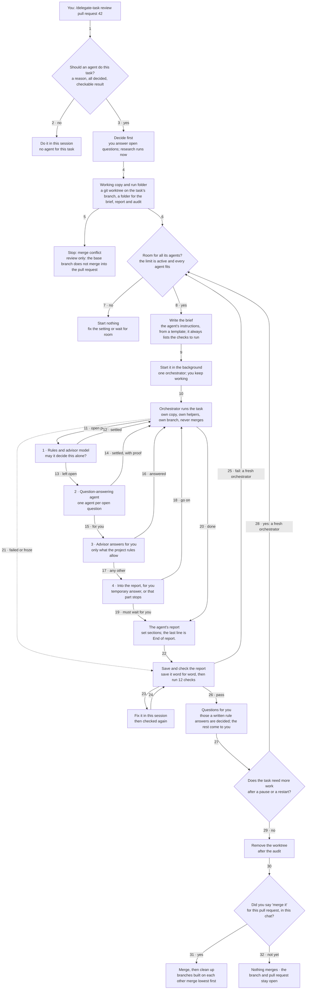

# delegate-task

A Claude Code skill that hands one decided task to a background agent. The agent has its own
helpers, its own copy of the repository and its own branch. The skill checks the result against
git before it believes the report.

**Navigation**

- [The problem it solves](#the-problem-it-solves)
- [When to use it](#when-to-use-it)
- [When not to use it](#when-not-to-use-it)
- [How it works](#how-it-works)
- [What the report holds](#what-the-report-holds)
- [How the result is checked](#how-the-result-is-checked)
- [What you are asked](#what-you-are-asked)
- [Who does what](#who-does-what)
- [What makes it different](#what-makes-it-different)
- [Where the skill is](#where-the-skill-is)

## The problem it solves

Some tasks are long but already decided: review a pull request end to end, apply ten fixes you
agreed on, build a feature from a finished design. Run in your conversation, such a task fills it
with diffs, test output and file reads, and you cannot do anything else while it runs. Handed to
an agent the usual way, it can come back with "Done, all tests pass", and you have no way to tell
whether that is true.

The skill is built against three ways such a hand-off can go wrong:

- **Your conversation fills up.** The work's own reading pushes out what you were thinking about.
- **"Done" is a claim.** An agent's report says what it believes it did, not what git shows.
- **Questions stop the work, or get guessed.** A background agent cannot ask you, so it either
  stops on the first open point or picks an answer for you.

delegate-task keeps your conversation for decisions and checking, gives the work to one lead
agent, the orchestrator, that runs the task and starts its own helpers, and counts nothing as done
until git and the checks agree with its report.

## When to use it

A task fits when all three hold:

| Condition | Example |
| --- | --- |
| There is a reason to use an agent: the task would fill your conversation, it should run beside other work, or it needs an independent check | A full pull request review with several reviewers |
| Every decision it needs is already made | Apply the twelve fixes agreed in yesterday's review |
| Its result can be checked with commands | Tests, linters, `git log` on the branch |

## When not to use it

| The case | Do instead |
| --- | --- |
| A question with a short answer | Ask one agent directly, or answer it yourself. |
| You want to know how the code works | [decompose-and-delegate](../decompose-and-delegate/README.md): agents return answers and change nothing. |
| One change you want to build and watch in your conversation | A build loop that runs in the conversation. |
| The work needs you while it runs, or decisions are still open | Decide first, or keep the work in your conversation. A background agent cannot ask you. |
| Nothing a command could check | Do it yourself: nothing can show whether the report is true. |

## How it works

You run `/delegate-task review pull request 42`, or `/delegate-task apply the agreed fixes from
review-notes.md`. The diagram follows the skill's own steps; each arrow has a number, and the
list under it says what happens on that arrow.

### Arrow by arrow

**Before the start**

1. You name the task. When the task has a skill of its own, you name that skill too: a review of
   pull request 42, applying agreed fixes, or a build from a finished design note. Before anything starts, the skill
   asks whether a background agent should do this task at all. This check (the gate) looks at
   three things: there is a reason to use an agent, every decision the task needs is already made,
   and commands (the tests, the type checker) can check the result.
2. One of the three fails: no agent starts, and the main session does the task in your
   conversation.
3. All three hold. The skill says in one line which reason it is: the task would fill your
   conversation, it runs beside other work, or it needs an independent check. A project may
   route every pull request review through this skill; then a review always passes the gate. Every open
   decision is now put to you, before any agent starts. Example: "The fixes touch the public API.
   Add them to the same pull request or open a new one?" Web research or a design note (the
   written result of a design step) the task needs is also done now, and what it gave goes into
   the brief.
4. The skill makes a separate working copy of the repository (a git worktree) on the task's own
   branch, and a run folder for the brief (the instruction file the agent reads), the report and
   the audit (the record of the 12 checks of arrow 22). It uses plain git, so it can name the branch and its
   base. When that task skill
   makes its own copy (a review does), the skill uses that copy instead.
5. Review only: before the start, the main session (your own Claude Code conversation) merges the
   base branch into the pull request's branch, so the review sees what will land. When that merge
   has a conflict, it is aborted and the run stops there.

**Count the agents**

6. Claude Code can limit how many agents run at once, and the skill expects the project's
   settings to set that limit. Two Claude Code settings change how that limit works, so the skill
   first checks the settings files: both must be off, and the agents it plans must fit under the limit. To check
   that, it adds up every agent already running (a running orchestrator counts with every helper
   its brief allows), the new orchestrator, and every helper its brief lets it start.
7. One of those settings is on, or the total goes over the limit: nothing starts. The run can start
   once the setting is off or enough agents have finished.
8. Both hold. The brief is written: a file in the run folder, copied from a template with every
   field filled. It holds the task and why it matters, what is in and out of bounds, the
   decisions it must not reopen, what it may and may not do, the helpers with their models, the
   checks to run (never "none"), and the exact shape of its report. For a task you asked for, it
   quotes your words.

**Start**

9. One orchestrator (the lead agent that runs the task) starts in the background with a three-line
   prompt: its role, the path of the brief, and the list of its helpers. A line in the run folder
   records the start, the worktree, the number of agents it may use and the branch's commit at the
   start. Your conversation goes on with other work. The skill does not poll the agent; it waits
   for the finish notice. Stay where you can answer: the skill expects the agent's permission
   prompts to appear in your conversation.
10. The orchestrator works in its own copy with its own helpers, commits and pushes only to its
    own branch, and never merges or downloads a file. It cannot ask you anything.

**While it runs: the order for a question**

11. It meets a point that no decision covers. First it reads the project's written rules and asks
    the advisor what it may decide alone. The advisor is a Claude Code tool: it sends the agent's
    whole conversation to a second model and returns its advice. A small decision, such as the
    name of a test helper, usually ends here.
12. They settle it: the orchestrator decides and goes on.
13. They leave it open: one question-answering agent gets the point. It answers one open point
    from the evidence and the written rules, and says either that the point is settled, with its
    proof, or that it is yours to decide.
14. The agent settles it: the orchestrator acts on the answer and posts it as a comment on the
    pull request, so the pull request keeps the history of the decision.
15. The agent says the point is yours to decide: it goes to the advisor again, now answering in
    your place.
16. The advisor may answer for you only the few kinds of point the project's written rules allow,
    for example which library package to use, and only when the answer changes no plan and not
    how the product works. The advisor names a source for its answer, the work goes on, and the
    report lists each such point under "Decided without you".
17. Every other point is written under "Questions for you" in the report.
18. Most such points get a working answer: a temporary answer the orchestrator uses so it can go
    on, while the question waits for you in the report. Example: "Should a failed upload keep its
    file for a retry?" gets the working answer "delete it, since the user uploads again anyway".
19. A few kinds get no working answer: a merge, a new dependency, a decision the brief left open
    that is hard to undo, a design question no design note covers. Only the work that depends on
    them stops. The rest of the task goes on, and the point waits for you in the report. In a
    review, points the review keeps for you end the run.
20. The task is done, or stopped: the orchestrator returns the report in a fixed shape. Every
    section is present, with "none" where it is empty, and the last line is `End of report.`
21. When the agent failed, was killed or froze, there is no report. A frozen run is found by the
    time of the last line in each agent's transcript, not by its status. The skill stops the
    orchestrator first, then its helpers: a helper that stops sends its lead a notice, and that
    notice can start a stopped lead again.
    The audit then runs on git and the run folder alone.

**After it ends: save and audit**

22. The report is saved word for word into the run folder. A report without `End of report.` was
    cut short and is copied by hand from the agent's transcript; the agent is never asked to send
    it again. Then 12 checks test what the report claims against git, against the task's checks
    run again at the final commit (the tests, CI), and against the run folder. Example: the
    commits the report names must be exactly the new commits on the branch (see [How the result is
    checked](#how-the-result-is-checked)).
23. A check failed: the task is not done. The main session can fix it in your conversation. A
    secret found in the pushed work comes to you first, before any new commit.
24. The failed check is run again after the fix.
25. Or a fresh orchestrator is briefed from the run folder, with the failed items (or the work a
    dead agent lost) as its task and a new run folder so the first report stays, and is counted
    against the limit again before it starts. Either way, the closing message still comes to you.
    It names each failed check and who takes it, and for a review the comment on the pull request
    says "Not ready to merge".
26. All checks pass. A question in the report that a written rule, a record or a practice already
    answers is decided, and listed with the words that answered it. This does not apply to the
    kinds that always come to you, such as a merge or a new dependency. The rest come to you one per
    message, each with options and a recommendation. For a review, the main session also runs the
    end-to-end tests itself when the pull request changes what they cover, since the agent may be
    unable to run them, and posts one comment on the pull request: "Ready to merge"
    with the commit and each check's result, or "Not ready to merge" with what is still needed
    and who gives it.

**Continue, clean up, merge**

27. Is work still left? For example, your answers need more changes, or a restart or a long pause
    cut the run short.
28. Yes: a fresh orchestrator is briefed from the run folder, and is counted against the limit
    again before it starts. The old one is not resumed: the
    skill's reason is that a resumed agent carries its whole history.
29. No: the skill removes the worktree itself, since it counts on nothing else to clean up a
    worktree made with plain git.
30. The orchestrator never merges. A merge needs you to type, in this conversation, that this pull
    request may merge. The review's "Ready to merge" comment is not that permission.
31. You said it may merge: the main session merges. When branches build on each other (each pull
    request's base is the branch below it), the lowest merges first, and each one only after you
    say that pull request may merge. Before an upper one merges, its base is moved to the main
    branch, the branch is synced, and the type checker, the tests and a search for removed names
    pass before the merge commit is pushed. After the merge, the run folders lose their large
    files (the reports, audits and decisions stay), and the merged branch is deleted.
32. You have not said it may merge yet, or there is no pull request: nothing merges; the branch
    and the pull request stay open.

## What the report holds

The orchestrator's report always has the same sections, in this order, with "none" where one is
empty:

| Section | What it says |
| --- | --- |
| Status | Done, partly done, or not done, and why |
| Branch, Commits | The branch and every commit it made |
| Checks | Each check the brief named, and its result |
| Limits, Not covered | What the checks it ran do not prove, and which parts of the task it did not reach |
| NOT RUN | Every step or helper that did not run |
| Deviations from the brief | Where it did something other than the brief said |
| Next | What it would do next |
| Decided without you | Each point it settled without you (by a written rule, by the question resolver, or by an advisor model acting for you), with what it rests on |
| Questions for you | What no rule answered |

The last line is always `End of report.`, so a report cut short is easy to spot.

## How the result is checked

The report is the agent's claim. Each item below checks it against something the agent cannot
write:

| Check | Against |
| --- | --- |
| The commits in the report are the commits on the branch, and no others | `git log` on the pushed branch |
| Each commit is on the agent's own branch, under the repository's identity | `git log` author and committer |
| No merge, no rewritten history, the pull request still open | `git log --merges`, an ancestry check, the pull request state |
| Nothing left uncommitted, nothing written into your main checkout | `git status` in both copies |
| Nothing downloaded from the internet | The commands in the agents' transcripts |
| Every changed file is inside the brief's bounds | The full diff, read |
| The checks pass at the last commit | The checks run again, or CI on the pushed commit |
| Every part of the task is in a commit or under "Not covered" | The brief against the diff |
| No personal data or secret left the machine | A search over the diff, the commit messages and the posted comments |

These rows group the checks that compare the report with git, the diff and the checks; the other
three are saving the report whole, passing the gaps to you, and removing the worktree.

A failed check means the task is not done: it is fixed in your conversation, or a fresh
orchestrator gets the failed items as its task.

## What you are asked

- **Before the start:** every decision the task still needs. Example: "The fixes touch the public
  API. Add them to the same pull request or open a new one?"
- **After the end:** only the questions that no written rule, earlier decision or practice
  answered, one per message, each with options and a recommendation.
- **The merge.** The orchestrator never merges. A merge needs your words in the conversation.

While the agent runs, it cannot ask you a question, but its permission prompts still appear in
your conversation, so stay where you can answer them. It first looks for an answer in the
project's written rules and asks an advisor model, then a separate agent that settles open
questions. For what is still open, it picks a working answer, goes on, and lists the question in
the report. A few kinds, such as a merge or a new dependency, get no working answer: the work that
depends on them stops.

## Who does what

| Role | What it does | What it may not do |
| --- | --- | --- |
| Main session (your own Claude Code conversation) | Decides, writes the brief, counts the agents, checks the report, talks to you | Take the report as true before the check |
| Orchestrator | Runs the whole task with its own helpers in its own copy; commits and pushes to its own branch; may open and comment on its own pull request | Merge, force-push, push to the default branch or another branch, download files |
| Helpers | The work the task's own procedure gives them (reviewers, fixers, checkers) | Go past what the orchestrator's brief allows |
| Question resolver | Answers one open question from the evidence and the rules | Decide a question that only you can decide |
| You | Decisions before the start, open questions after the end, the merge | Nothing: you decide what no rule decides |

## What makes it different

| Choice | Why |
| --- | --- |
| Only decided tasks go out | A background agent cannot ask you. An open decision would either stop it or get guessed. |
| One orchestrator per task, with its own helpers | Your conversation keeps one line of contact and one report, however many agents the task needs. |
| A separate copy on its own branch | The agent's work cannot mix with yours or with another agent's. |
| Agents counted before the start | A task that starts helpers of its own can cross the limit on agents running at once without anyone noticing. |
| The brief is a file, written from a template | The same fields every time, and the run folder keeps what the agent was told. |
| A report with fixed sections and a closing line | Empty sections say "none", so silence never reads as "fine", and a cut report shows. |
| The report is checked against git and the checks | "Done" counts only when the branch, the diff and a check run say so. |
| Questions filtered before they reach you | A written rule, an earlier decision or a resolver answers what it can; you see the rest. |
| A fresh orchestrator rather than a resumed one | A resumed agent carries its whole history; a fresh one starts from the run folder's records. |

## Where the skill is

The skill itself is not published in this repository. This page describes its design in general
terms, so you can build a hand-off of your own or judge whether one would help you.
