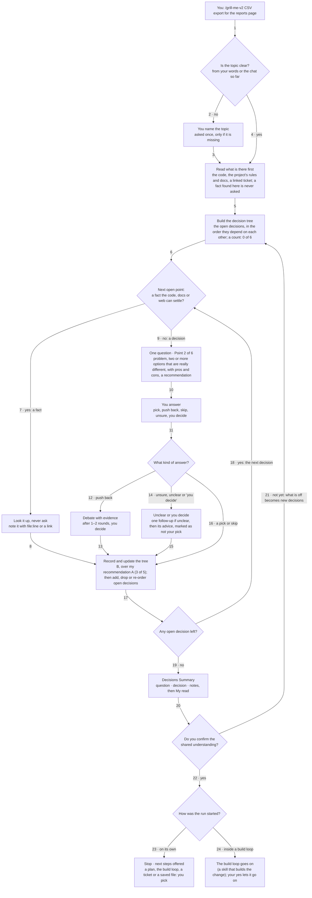

# grill-me-v2

A Claude Code skill that pins down the requirements for a feature, change or idea before anything
is planned or built. It asks you one question per message, each with options and a
recommendation, looks up every fact instead of asking, and ends with a Decisions Summary you
confirm.

**Navigation**

- [The problem it solves](#the-problem-it-solves)
- [When to use it](#when-to-use-it)
- [When not to use it](#when-not-to-use-it)
- [How it works](#how-it-works)
- [What a question looks like](#what-a-question-looks-like)
- [What you are asked](#what-you-are-asked)
- [What makes it different](#what-makes-it-different)
- [Where the skill is](#where-the-skill-is)

## The problem it solves

You ask Claude for "a CSV export on the reports page". It starts building at once. Which columns,
which filters, what happens with 200,000 rows: it guesses, and you find the guesses in review. Or
it asks first, but sends ten questions in one message, and half of them are about things the code
already shows. The skill is built against five ways such a requirements talk can go wrong:

- **Guesses become the spec.** Open decisions are filled in silently, and nobody sees which ones
  were guessed.
- **A wall of questions.** Ten questions at once: you answer some, skip others, and the order in
  which they depend on each other is lost.
- **Questions the code could answer.** "Which database do you use?" costs you time and tells the
  agent nothing it could not read itself.
- **A question with no recommendation.** "A or B?" leaves the analysis to you.
- **Silent agreement.** Your first idea is taken as it is, even when the code shows a problem
  with it.

grill-me-v2 keeps facts and decisions apart, puts each decision to you on its own with a
recommendation, and starts nothing until you confirm the result.

## When to use it

- A feature, change or idea is still vague, and a wrong guess would be expensive.
- You want to collect or sharpen the requirements before any plan or code exists.
- You want an idea stress-tested: every open decision named, with options and their costs.

## When not to use it

| The case | Do instead |
| --- | --- |
| A plan, ticket or doc already exists and has open points | Go through its points with you, one at a time ([settle](../settle/README.md)). It uses the same question format for a review. |
| You want a written diff reviewed | A code review. This skill asks about what to build, not about code already written. |
| You want the change built, not only specified | A build loop that takes one change from decision to commit. Its first step runs this same interview, but skips decisions that have a safe default. |
| A large task where the route itself is still open | Think the route through first ([meta-thinking](../meta-thinking/README.md)), then interview on the chosen route. |
| The task is clear and nothing is left to decide | Go straight to planning or building. The interview exists to find open decisions; with none, it has nothing to ask. |

## How it works

You run `/grill-me-v2 CSV export for the reports page`, or Claude starts it on asks like "gather
the requirements" or "stress-test this idea". The diagram follows the skill's own order: read what is already there
first, build a tree of open decisions, walk it one question at a time, then confirm. Each arrow
has a number, and the list under it says what happens on that arrow.

### Arrow by arrow

**Start and read what is there**

1. You start the run with a topic: a feature, a change or an idea. You can add a file or a
   ticket for the skill to start from.
2. The topic is really missing, both from your words and from the chat so far: the skill asks you
   once what to gather requirements for.
3. With the topic named, the skill goes on to read what is already there.
4. The topic is clear: the skill starts reading what is already there straight away.
5. Before the first question, the skill takes a quick pass over what is already there: the
   project's code, its instruction files and rules, its architecture docs (it keeps in mind any
   note that says a doc is out of date), a ticket you linked. This makes the questions and the
   options concrete, with `file:line` where the code matters. A fact settled here never becomes a
   question. What is still open becomes a decision tree. Decisions depend on each other: whether
   the export runs in the browser or on the server decides whether file size is a question at all.
   The skill keeps the open decisions as a queue in that order and shows the count, such as
   "0 of 6".
6. It takes the next open point in the tree and first asks itself: is this a fact or a decision?

**One branch at a time**

7. A fact is anything the environment can settle: the files, the code, the docs, the web. Example:
   "Which CSV library does the project already use?" The skill looks it up and never asks you.
8. The fact is noted with its `file:line` or link and shapes the questions that follow; it is not
   counted as one of your answers.
9. A decision is yours: product judgment, scope, taste, priority, how much risk you accept. The
   skill puts every one to you, even one it could settle with a default, because you asked to be
   questioned. (When the same interview runs as the first step of a build loop (a skill that takes one change from decision to commit), the loop skips the
   decisions that have a safe default.)
10. One point per message, never a list. The point has a title with "Point N of M", a problem you
    can follow with no earlier context, two or more options that are really different, each with
    pros and cons for this project, and a recommendation with its reason. When only one answer
    makes sense, the skill says so and asks you to confirm it. When "take a default now and come
    back later" is a real option, it is listed with what would reopen it. When the skill has no
    evidence for a recommendation, it says what it would need instead of forcing a pick. Then it
    stops and waits.
11. Your answer goes to one check: what kind of answer is it?

**Your answer**

12. You disagree. The skill acts as an independent consultant, not as someone who agrees with
    everything. It answers with specific evidence and does not give in at the first push back. When you show something it missed, it says so
    and changes its recommendation.
13. If you still disagree after one or two rounds of real argument, it states both positions and
    you decide. The record says so: "You chose X over my recommendation Y, because …".
14. Your answer is unclear, or you say "you decide".
15. Unclear: the skill asks one focused follow-up question. If that does not settle it, the
    recommendation becomes the decision and is recorded as a default. "You decide": the
    recommendation becomes the decision, and the notes say you handed it over. Either way the
    Decisions Summary shows the decision was not your own pick.
16. You pick an option, or you say "skip". A skip is recorded, and the run moves on.

**Next branch**

17. The skill confirms the answer in one sentence: whether you followed or overrode its
    recommendation, or whether it revised the recommendation after your argument, with the count.
    Example: "Resolved: Option B, over my recommendation A (3 of 5)." Then it updates the tree: an answer can open new branches, make others unneeded, or change
    the order, and the skill announces the new total. A new concern you raise along the way joins
    the queue too; the current point is finished first.
18. Decisions are still open: the next point comes at once, in the next message.
19. Every queued question is answered: the skill writes the result.

**Confirm and hand over**

20. The Decisions Summary is a table with one row per question: number, question, decision, notes.
    The notes hold what came out of a debate, your overrides, defaults taken on an unclear answer,
    and decisions you handed over. Under it comes one paragraph: "My read: we want [what] so that
    [end state], under [the decided constraints]." The skill asks you to confirm this shared
    understanding.
21. You do not confirm: nothing is planned or built yet. The interview runs until you and the skill
    understand the task the same way, not until the questions run out, so what is off goes back
    into the tree as new decisions.
22. You confirm. Where the run goes now depends on how it was started.
23. Started on its own: the skill offers the next steps and starts none of them itself. You pick
    one: a planning step that drafts a plan; the build loop (the loop that takes one change from
    decision to commit), with these answers passed in as decisions already made, so its own
    questions have nothing left to ask; a ticket; or a requirements file, saved in a dated folder
    where the project keeps its working notes, or in a temporary folder when it has none.
24. Started as the requirements step inside a build loop: the loop waits for your yes, and then
    goes on to its next stage. No next steps are offered.

## What a question looks like

Every question comes in one message, in the same parts:

| Part | What it holds |
| --- | --- |
| Point N of M | Where you are in the queue; M changes when an answer opens or closes branches |
| Problem | What is still open, why it matters, and how the options differ, readable with no earlier context; `file:line` where the code is part of it |
| Options | Two or more that are really different, each with what it means, pros and cons for this project. One sensible answer: the skill says so and asks you to confirm |
| My recommendation | The option it would pick and why, based on this project's code and docs. No evidence: it says what it would need |

An example, in plain words:

> **Point 2 of 6: Where the export runs**
>
> **Problem:** The reports page can show up to 200,000 rows, but it loads them from the server
> 500 at a time (`reports/api.py:88`). Where the CSV is built decides whether file size and
> timeouts are questions at all.
>
> **Option A: In the browser.** Build the file from the rows the page already has.
> - Pros: no new endpoint; done in a day.
> - Cons: it exports only the 500 loaded rows; a large export can freeze the tab.
>
> **Option B: On the server.** A new endpoint writes the CSV and the browser downloads it.
> - Pros: any size; the same filters as the page.
> - Cons: one more endpoint to secure and test.
>
> **My recommendation:** Option B, because the page already gets its data from the server in
> pages, so a browser export would quietly miss most rows.

Then the skill stops and waits for your answer.

## What you are asked

The skill stops for you in four cases:

- **Each open decision.** Scope, product judgment, taste, priority, how much risk you accept. One
  per message, in the format above. You can pick, push back, skip, or say "you decide".
- **The topic, once.** Only when neither your words nor the chat say what to gather requirements
  for.
- **When you disagree.** It answers with evidence. After one or two rounds of real argument it
  states both positions and asks you to decide. Example: "You want Option A to ship this week; I
  still recommend B because A drops rows. Your call: A or B?"
- **The confirmation.** At the end you see the Decisions Summary and its "My read" paragraph, and
  you confirm the shared understanding or say what is off. Run on its own, the skill then asks
  which next step you want and starts none by itself.

## What makes it different

| Choice | Why |
| --- | --- |
| One question per message | Several questions at once confuse you and lose the order in which decisions depend on each other. |
| Questions follow the decision tree | An early answer changes which questions come next, so the tree is updated after every answer. |
| Every question carries a recommendation | A question without one is half the work pushed onto you. |
| Facts are looked up, never asked | Only decisions are yours. Anything the code, docs or web can settle is settled there. |
| Every open decision goes to you, even ones with a safe default | You asked to be questioned. A build loop that uses the same interview skips those defaults; this skill does not. |
| Options only when they are really different | Padding hides the real choice. With one sensible answer, the skill asks you to confirm it. |
| No forced recommendation | Without evidence it says what it would need, instead of guessing with confidence. |
| It pushes back with evidence | Silent agreement is the failure the skill is built against; your override is recorded with your reason. |
| It ends on your confirmation, not on an empty queue | The goal is a shared understanding, so nothing is planned or built before you confirm it. |
| It offers the next step and never starts it | What comes next (a plan, a build, a ticket, a saved file) is your choice. |

## Where the skill is

The skill itself is not published in this repository. This page describes its design, so you can
write an interview of your own or judge whether one would help you.

Its interview technique builds on the public `grilling` skill in Matt Pocock's skills repository
[1], put into a format of one question per message, each with options and a recommendation.

[1] Matt Pocock, skills: grilling — https://github.com/mattpocock/skills/tree/main/skills/productivity/grilling
