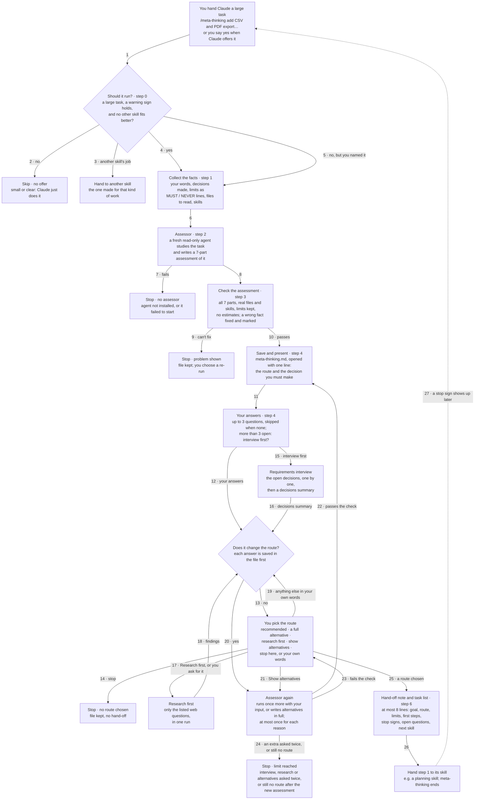

# meta-thinking

A Claude Code skill that thinks a large task through before any work starts: one independent
agent proposes a route, and you are asked only what the code cannot answer.

**Navigation**

- [The problem it solves](#the-problem-it-solves)
- [When to use it](#when-to-use-it)
- [When not to use it](#when-not-to-use-it)
- [How it works](#how-it-works)
- [What you are asked](#what-you-are-asked)
- [What makes it different](#what-makes-it-different)
- [Where the skill is](#where-the-skill-is)

## The problem it solves

You give Claude a large task, "add CSV and PDF export of the monthly reports", and it starts
editing at once. Halfway through you find out what nobody said out loud: export for whom, which
PDF library, does the URL become public? Now the fix costs a rewrite.

The skill rests on one premise: a large task rarely goes wrong because the code is bad. It goes
wrong because of a missing requirement, a scope edge that reads two ways, a name or a format that
later work cannot cheaply change, or two approaches where the agent silently picked one. The
studies behind this premise are in the skill's
[README](../../skills/meta-thinking/README.md#the-problem-it-solves).

A plan step alone does not fix it: on a small task it costs more than it gives. So the step is
short, skips small tasks, and puts in front of you only the decisions that are yours.

## When to use it

A task that spans several parts, or cannot be said as one change in one sentence, and at least
one of these holds:

| Signal | Example |
| --- | --- |
| A requirement is missing or reads two ways | "Add export": to where, for whom, in which format? |
| Two approaches both work and differ in something you care about | A PDF library, or render HTML to PDF |
| A decision is hard to undo | A new public URL that scripts and bookmarks will depend on |
| The area is new to the project | The first background job in an app that has none |
| The result cannot be checked quickly | A change whose effect shows only in next month's report |

## When not to use it

| The task is | Do instead |
| --- | --- |
| Small or clear, one obvious route | Just do it. The skill's first check skips it anyway. |
| One scoped change ("fix X and add a test") | Make the change. |
| Clear on the route, unclear on the requirements | A requirements interview. |
| A route already chosen, and you need a plan by file | An implementation plan. |
| A question about how existing code works | [decompose-and-delegate](../decompose-and-delegate/README.md). |

## How it works

You run `/meta-thinking add CSV and PDF export of the monthly reports`, or Claude offers it at the
start of a large task and waits for your yes. The diagram follows the skill's own steps (0 to 6);
each arrow has a number, and the list under it says what happens on that arrow.

### Arrow by arrow

**The gate (step 0)**

1. You give the task: `/meta-thinking <the task>`, `/meta-thinking` alone to use the conversation
   so far, or a yes when Claude offers the skill. With no task anywhere, Claude first asks you once
   what it is.
2. The task is small or clear: it stays in one part and can be said as one change in one sentence,
   or none of the five warning signs holds (a requirement is missing or reads two ways; two good
   approaches differ in something you care about; a choice on the way is hard to undo; the area is
   new to the project; the result cannot be checked quickly). When Claude only tests whether to
   offer the skill, it offers nothing, prints nothing and does the task without it.
3. The task is a job for another kind of skill: one scoped change, a ticket you want run end to
   end, unclear requirements on an obvious route, a route already chosen that needs a plan by
   file, or a question about how code works. It goes to the session's skill for that work; when
   there is none, the main session (your own Claude Code conversation) does it.
4. The task is large and at least one warning sign holds. The skill prints its verdict, for example
   `[meta-thinking] gate: run — signals a, c` (a: a requirement is missing, c: a decision that is
   hard to undo).
5. You named the skill yourself, but the gate would not run it: it runs anyway and prints
   `[meta-thinking] gate: run (would skip: <reason>)`, so you can stop it.

**The assessment (steps 1 to 3)**

6. The main session writes the brief for the assessor: your words as you wrote them, the decisions
   already made, each constraint as one `MUST` or `NEVER` line with its source (for example
   `NEVER change the current URLs`), the files to read as paths, and the skills in the session.
   It leaves out its own opinion of the answer and reads no code itself.
7. The assessor's agent type is not installed, or the start fails for another reason: the run
   stops and says why. There is no fallback agent, because one that could edit, go to the web or
   start other agents would not be this step.
8. One agent with an empty context, which can only read, studies the brief and the repository and
   returns the assessment in seven parts (listed below). An empty answer still goes to the check.
9. A defect the main session cannot fix in place with a marked note (arrow 10 shows those notes): a
   missing part, a route with no steps, more questions, steps or routes than allowed, a text over
   its 200-line limit, or a second full route with no reason given. The skill shows what came back,
   names the defect, keeps the file and stops; you choose whether to run it again. It never trims or
   re-ranks the assessment itself.
10. The assessment passes. On the way, a wrong path is fixed in place and marked
    `[corrected: …]` or `[not found]`, a skill the session does not have is marked
    `[no such skill]`, a question the repository can answer is looked up and marked
    `[answered: …]`, and any success, time or token estimate is struck out.

**Your review (step 4)**

11. The assessment is saved as `meta-thinking.md` in the task's folder, or in the session's
    scratchpad, which lasts only for the session (it tells you the path). It is shown, opened by
    one plain line: the recommended route and the decision you must make. Then part 3's questions
    are asked, the recommended option first. With no questions, this step is skipped.
12. Each answer is written under the heading `Decided:` in the file, one line each, for example
    `answer 1 → B: render the HTML page to PDF — you, question 1`. A question you leave unanswered
    goes under `Open:` and stays open; the skill never decides it for you.
13. A shown route still stands: the route question asks you to pick it. The options are the
    recommended route, each full alternative route shown, `Research first` when there are web
    questions, `Show alternatives` when no full alternative is shown yet, and `Stop here` when
    there is room (at most four options).
14. You pick `Stop here`, say no in your own words, or give no answer: the run stops with no route
    chosen. The file stays, and nothing is handed on.

**Extras: only when you ask, at most once each (step 5)**

15. With more than three open decisions, the questions get one more: "Go through the open
    decisions one by one first?" A yes (`Grill first`) starts a requirements interview, with the
    session's interview skill or with the main session asking one decision per message. You can
    also ask for it in your own words when you answer the route question.
16. The decisions summary comes back. A decision you skipped or left on its default goes under
    `Open:`, not `Decided:`.
17. `Research first`, or a request for research in your own words, looks up only the web questions
    in part 4, in one run, with the session's web research skill or the main session's own web
    tools. With no web questions listed, your request becomes the one question.
18. The findings come back, each with its source.
19. Any other answer you write in your own words to the route question is handled like an answer to
    the questions.
20. The answer, finding or decision changes the route: no shown route survives your answers, or a
    finding or decision meets a route's `wrong if:` line (each route names what would prove it
    wrong) or an item's "would change the route" note. The assessor runs again, with the new input
    added to its brief.
21. `Show alternatives`: the assessor runs again and writes up to two of the one-line alternatives
    as full routes, the ones you named or else the first two. The recommended route stays first.
22. The new assessment passes the same check as arrow 10 and is saved as the next numbered file,
    such as `meta-thinking-2.md`, with the `Decided:` lines carried over; earlier files stay. Its
    new questions are asked first.
23. The new assessment fails the check, or the agent errors: the previous file stays, the skill
    names the defect and asks the route question again without the option that caused it. When
    your answers caused it, no shown route is left, and the run stops as in arrow 14.
24. Each extra (the interview, the research, the full alternatives) runs at most once, and your
    answers start at most one new assessment. Once an extra has run, the route question no longer
    offers it. A second request for the same extra, or a new assessment that still leaves no route
    standing, stops the run and names the reason.

**The hand-off (step 6)**

25. You pick a route. The main session writes a hand-off note (the skill calls it a backbrief) at
    the end of the file, at most 8 lines: the goal, the chosen route, the constraints as `MUST` or
    `NEVER` lines, the first two steps, the stop signs (the skill calls them stop triggers: two or
    three things that, seen during the work, mean "stop and think again"), `Open:` with every
    unanswered question, and the next skill. The route's steps go into the task list in order, plus
    one standing task that watches the stop signs, so they survive a long session.
26. The first step goes to the skill it names, for example a planning skill for the plan by file,
    with only that step as its task, the hand-off note and the file path as context, and the
    `Decided:` lines as decisions already made. A step with no skill runs in the main session.
    Before a step closes, its report is checked against the stop signs. From here the next skill's
    own rules apply, and meta-thinking ends.
27. A stop sign shows up during the work, for example the chosen PDF library cannot break pages in a
    table: the work stops and the skill runs again with the new facts and the old file. This re-run
    counts as accepted, so Claude does not offer it first.

### What the assessment holds

1. the goal, what to decide now, what is out of scope, and the limits as `MUST` / `NEVER` lines;
2. what is known, and what is only assumed;
3. at most three questions for you;
4. at most three things to look up on the web;
5. one recommended route of at most seven steps, each with what to do, why, how to check it and
   which skill does it;
6. one line per option it rejected;
7. two or three signs during the work that mean "stop and think again".

The skill never writes code, a plan by file or a ticket, and gives no chance of success, time or
token estimate.

## What you are asked

At most three questions, once, and each is a real decision with two or three options and a
recommendation. Example: "PDF export: a PDF library (more control, one more dependency) or render
the HTML page to PDF (reuses the screen, harder to page-break)? Recommended: the HTML route,
because the report screen already exists." A question the repository can answer is looked up,
not asked. A question you leave open stays open; the skill never decides it for you. You also
pick one route; the plan recommends one.

## What makes it different

| Choice | Why |
| --- | --- |
| A first check that skips small or clear tasks | Planning costs a little on tasks the agent would solve anyway. |
| A separate agent with a fresh context | Its brief carries your words, never the favourite answer of the main session (your own Claude Code conversation), so it does not inherit the session's first guess. |
| Constraints written as `MUST` and `NEVER` lines | Vague constraints get lost when work passes from one agent to another; plain rules survive. |
| At most three questions, each a real decision | You answer only what the code cannot. |
| One recommended route, the others in one line each | A full second route shows up only for a hard-to-undo choice, a fork a cheap test can decide, or when you ask. |
| The goal restated, and the steps in the task list | The doer says the intent back before starting, and the steps survive a long session. |

Each reason rests on findings listed in the skill's
[research basis](../../skills/meta-thinking/research-basis.md).

## Where the skill is

The skill is published in this repository: [skills/meta-thinking/](../../skills/meta-thinking/).
Its [Install](../../skills/meta-thinking/README.md#install) section says how to copy it and its
agent into your setup.
