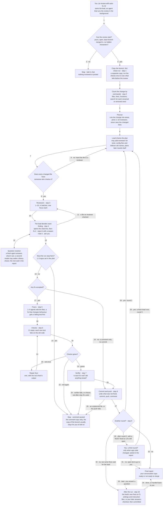

# pr-review-with-auto-fix

A Claude Code skill that reviews your own pull request with a team of reviewers. Each takes one
part of the change and one kind of problem. The skill checks every finding, fixes what holds up,
and proves the fixes by running the project's checks.

**Navigation**

- [The problem it solves](#the-problem-it-solves)
- [When to use it](#when-to-use-it)
- [When not to use it](#when-not-to-use-it)
- [How it works](#how-it-works)
- [Which reviewers run](#which-reviewers-run)
- [MUST, SHOULD, NICE: what gets fixed](#must-should-nice-what-gets-fixed)
- [What you are asked](#what-you-are-asked)
- [Who does what](#who-does-what)
- [What makes it different](#what-makes-it-different)
- [Where the skill is](#where-the-skill-is)

## The problem it solves

You ask Claude to review a pull request. You get twenty comments and cannot tell which are true.
The skill is built against five ways such a review can go wrong:

- **Comments without proof.** "This can return null" — nobody opened the line to check.
- **Files nobody read.** The reviewer got twenty files, read twelve, and the report does not say
  which eight it skipped.
- **The description steers the review.** The pull request says "small refactor, no behaviour
  change", and the reviewer believes it.
- **"Looks fixed" instead of a test run.** The fix is judged by reading, not by running the
  tests.
- **"Clean" when it means "nothing found".** You cannot tell a careful review from a quick one.

pr-review-with-auto-fix answers each one: the lead opens the cited line of every finding, a command checks
that a reviewer or a tool covers every changed file, or names it as not reviewed; every
reviewer marks each file checked or not reviewed; the description is read last; the tests run; and
every report lists what was not checked.

## When to use it

- Right after you open a pull request, before you ask a person to review it.
- A pull request that touches several areas or risky paths, where one reviewer would skim.
- A repository with written rules and checks you can run locally: the reviewers judge by those
  rules, and the fixes are proven by those checks.

## When not to use it

| The case | Do instead |
| --- | --- |
| A one-line change | Read it yourself. Even a run that finds nothing costs a planner, a reviewer and a full check run; a round with fixes adds fixers, a verifier and another check run. |
| Someone else's pull request, a fork or a dependency bot | Nothing yet: the skill stops. Code you do not own needs decisions first: what reviewers may search on the web, and whether to trust instruction files from the other branch. |
| You want comments only, with no fixes | A review that comments and changes nothing. |
| You need the pull request written | A skill that drafts the description, such as [pr](../../skills/pr/SKILL.md) in this repository. |
| A repository with no written rules and no runnable checks | A plain review. Without rules the reviewers have nothing to judge by, and without checks nothing proves the fixes. |

## How it works

You run `/pr-review-with-auto-fix 42`, or `/pr-review-with-auto-fix` alone for the open pull request
of your current branch. Every review runs in the background through
[delegate-task](../delegate-task/README.md), a skill that hands one task to a background agent and
checks its report against git. That agent is the lead (the agent that runs the review), and your own
conversation checks the lead's report. The diagram follows the skill's own steps (1 to 10); each
arrow has a number, and the list under it says what happens on that arrow.

### Arrow by arrow

**Start**

1. You start the run. Before anything is spawned, the lead checks that the pull request is yours,
   open and not from a fork, that the git identity is set, that Claude Code is new enough, that no
   copy of the branch is left from an earlier run, that the base branch is already merged into the
   pull request, and that the diff holds no hidden Unicode characters.
2. A check fails, for example the pull request comes from a fork: the run stops and the lead says
   why in chat. Nothing is reviewed and no comment is posted. When the only problem is that the base
   branch is not merged into the pull request yet, your conversation brings it in and starts a fresh
   lead.
3. All checks pass. The lead works in a separate copy of the branch, never in your own folder. It
   saves the pull request's description and, when the change does something you asked for in chat,
   your words, so the review can measure the change against them. Then it runs the project's checks
   once, so it knows which ones already failed before the review.

**Plan the review**

4. Commands, not judgment, count the change: the changed files, the lines per file, and the
   function each change sits in. When the change renames or removes a word, a path or a rule, a
   search lists every line in the repository that still names it, for example every doc that still
   names a renamed setting.
5. The planner gets the lists, the counts, the description as the author's claim and your words,
   never the changed lines. Often the conversation that runs the review also wrote the change, and a
   model goes easier on its own work, so who reviews what is decided by an agent that has not seen
   the lead's reading of it. The planner cuts the change into areas, marks the risky ones (code that
   takes input from outside, such as an API route, settings, a migration, CI) and picks 1–10
   reviewers: one for a small change of one area, more as areas and lines grow. A planner that fails
   twice is replaced by the lead, which plans by the same rules.
6. The lead has read the diff and the planner has not, so it may add to the plan, never remove. It
   adds a reviewer that judges whether each new or changed test is worth keeping, when a test
   changed; a reviewer that checks config files (a Dockerfile, a CI workflow, the dependency list)
   against the tool's own documentation; a reviewer that reads every line the search of arrow 4
   found and says which ones now contradict the change; and one reviewer for a risk only the diff
   shows, such as a secret in a settings file. It also writes findings of its own: a changed file
   that no claim of the description explains, a package nothing uses, a feature or job the change
   takes on that you did not ask for.
7. Before any reviewer starts, a shell command makes sure that no changed file is left unread. It
   compares the list of changed files with the plan. Each file must be handled in one of three
   ways. Usually a reviewer has the file in its list and reads it in full. A file that a tool
   writes and a tool checks, such as the lock file of the dependencies, is left to that check: the
   install step in CI fails when the lock file is wrong, so no reviewer reads it. A file that no
   reviewer can read, such as an image or a large data file, goes into the report as "not
   reviewed", with a question for you: does this file belong in the repository?
8. The command finds a file that none of the three handles. The lead adds it to the list of the
   reviewer whose part of the change is closest, and runs the command again.
9. Every changed file is handled, and the reviewers start. One to ten run, in batches, because the
   lead may run only a set number of agents at once. Each runs in a fresh context, read-only, with
   one focus on one part, for example security on the login code. Each reads its files in full
   against the project's rules as they stand on the base branch, so the pull request cannot loosen
   the rules it is judged by. For every file it writes `checked` or `not reviewed`. A reviewer that
   cannot start, because the limit on agents running at once is reached, is listed as not run, and
   its files as not reviewed.

**Review and triage**

10. The findings go to the lead, and the lead alone decides them. Each finding has a severity: MUST
    (wrong, breaks at runtime, a security hole or a broken hard rule), SHOULD (works, but at a real
    cost) or NICE (clarity or style only). The lead opens the cited line of every MUST and SHOULD
    finding and checks the quote, the rule and how the code would fail. Each finding gets one
    decision: accept (a fixer applies it), push back (reject it with a reason; the default when
    unsure), backlog (a NICE item, written down but not tracked after the run), ask you, or "after
    the run" (a fix with one right form in a CI file, a settings file or an instruction file, which
    no fixer may touch and the lead makes at the end). Deleting a test needs proof: the lead breaks
    the code on purpose, and another test must fail.
11. Before the lead decides any finding, it compares each reviewer's file marks with the files it
    gave that reviewer. A file with no `checked` line gets one more reviewer with the same focus,
    which reads only those files, once. A file that is still unchecked goes into the report as not
    reviewed. The skill's premise: a reviewer given too many files skims some of them and does not
    say which.
12. Before a question is left for you, it goes to the question resolver, a fresh agent that gets the
    question and its evidence, never the lead's draft answer. It may settle a choice between two
    fixes that both make sense. What it cannot settle goes to the advisor, a second model that may
    decide in your place in a few cases, for example a library choice when it names a source. Some
    kinds always wait for you in the report, with the resolver's answer beside them: a network call,
    a CI permission, overruling a decision you made.
13. With every finding decided, the lead checks the stop signs it wrote into the plan: one to
    three things that, seen in the round, mean "stop and tell
    you".
14. A stop sign fires, for example "the change turns off a security check": the lead posts the whole
    decisions table as the round's comment, and no fixer runs. The copy of the branch is removed
    when it holds no change, otherwise it stays for you. After you answer, a new run starts at
    round 1.
15. No stop sign fired.

**Fix and prove**

16. Nothing was accepted: the round goes straight to its comment, with no fixer, no verifier and
    no commit.
17. The accepted fixes are split by file into one to four groups, no file in two groups. Each fixer
    gets the lead's own description of its fixes, not the reviewer's finding, and changes only its
    files. When a fix changes behaviour, the fixer writes the test first and sees it fail. A fix it
    cannot apply as written comes back and becomes a push back or a question for you.
18. The fixers are done; they never touch git.
19. The lead runs the project's CI steps in their order, plus the slower suites that CI skips on
    pull requests when the change touches what they test. Each new test for a changed behaviour also
    runs against the old code in a scratch copy and must fail there. A test that passes there proves
    nothing: its fix goes back to the lead's decisions in the next round (after the last round, to
    you). A new test for behaviour the code already had must fail on a small break the lead names;
    if it does not, its fix is undone and goes the same way.
20. A check is red that was green at the start: one repair fixer gets the check's output and only
    the files it names. It is one of the four fixers a round may use.
21. The checks run again.
22. Red again, all four fixers already used, or a check fires a stop sign: the run stops before the
    verifier. Nothing is committed, the comment says which check failed and why, and the copy of the
    branch stays for you.
23. All green, or red only where a check was already red at the start. A fresh verifier reads the
    files on disk, not the fixers' notes, and rates each fix: fixed, partly fixed or not fixed. It
    also lists regressions (something broke) and slips (small leftovers that break nothing, such as
    a wording or a blank line; they are named in the comment and not fixed). Its verdict never
    overrides a red check.

**Verify and land**

24. The verifier errors or returns a broken report, or a check turns red after the lead undoes a fix
    (the undo of arrow 25): the run stops before the commit. No repair fixer runs here, because its
    edit would land unread.
25. The lead undoes every fix rated "not fixed" and every regression, then runs the checks again.
    Partly fixed and not fixed items and the regressions go to the next round (after the last round,
    to you). Then it checks that every changed file belongs to an accepted fix, checks the git
    identity, stages file by file, scans for personal data and secrets, commits, pushes to the pull
    request's branch and posts one comment. The comment never says "clean": its verdict is "fixes
    verified" or "fixes not verified", and it lists what was not checked.
26. Something blocks the commit or the push: a changed file that belongs to no accepted fix, a pull
    request that is no longer open, a branch someone else moved, or a rejected push. A round that
    moves code between folders commits that move on its own, and a check that fails on that commit
    alone also blocks the push. The run stops, and the comment says the push did not land.
27. The comment is posted. The lead decides whether another round runs.

**Next round or stop**

28. Round 2 runs in three cases: round 1 left a fix partly done, not done or broken; the verifier
    asks for another round; or the change is large, 1,000 changed lines or more. The lead plans it
    itself, with fresh reviewers: a reviewer that found nothing serious does not run again, and the
    word search runs again on round 1's commits. On a large change every file meets a reviewer with
    another focus or of another area than in round 1.
29. Round 2 is done, and it accepted a MUST finding or left a fix open. A third round is possible
    only when the change touches application code. The lead asks once, in the final report, with the
    items that would carry over.
30. You say yes: your conversation starts a fresh lead, which runs round 3 in the same run folder
    by round 2's rules. What round 3 leaves open goes to you.
31. You say no: the open items go to you, and the run ends.
32. No further round runs: round 1 left nothing open and the change is not large, or round 2 is
    done and no third round is possible. The final report goes to your conversation, which checks it
    and posts the one comment that says "ready to merge" or "not ready to merge". The skill never
    merges; you do.
33. The run ends with fixes kept for the lead ("after the run" in arrow 10): the lead makes them
    now.
34. The lead makes the edit in a copy of the branch, runs the checks without a repair fixer, and a
    fresh verifier reads it. Only green checks and "fixes verified" let the edit land, in a commit
    of its own with its own comment; otherwise nothing is committed and the items go back to you. A
    verifier that asks for another round starts none: the report names it.
35. Later, you answer a question from the report in chat. That edit goes through the same steps as
    arrow 34: a copy of the branch, the checks, a fresh verifier, then a commit of its own.

## Which reviewers run

Each reviewer looks at one part of the change for one kind of problem:

| Reviewer | The question it asks | When it runs |
| --- | --- | --- |
| Architecture | Is the code in the right place, do imports point the right way, is anything here that nothing needs yet? | A part has a design to judge |
| Security | Are inputs checked, secrets kept out, permissions tight, dependencies pinned? | A part touches a risky path: login, payments, user input |
| Tests | Is new behaviour tested, and would each test fail if the code broke? | A part adds behaviour or changes tests |
| Test value | Does each new test earn its place: keep, rewrite or delete? | The lead adds it when the change adds or edits a test |
| Consistency | Do two lines now say opposite things? Does anything point to a renamed or removed name? | The lead adds it when the word search finds a hit |
| Practices | Does each file follow the project's own written rules for its kind? | A kind of file has a written rule |
| Standards | Do config files match their tool's own docs: manifests, Dockerfiles, CI, env files? | The lead adds it when such a file changes |

Each reviewer judges by the project's own rules first. When current industry practice says
something else, the project rule still decides the finding, and the reviewer adds the industry
point as a question for you.

## MUST, SHOULD, NICE: what gets fixed

| Priority | Means | Example |
| --- | --- | --- |
| MUST | Wrong, breaks at runtime, a security hole, or a hard project rule broken | The new endpoint reads the user id from the request body, so anyone can act as anyone. |
| SHOULD | Works, but at a real cost | The same query runs once per item in a loop. |
| NICE | Could be better, no real cost | A variable name could be clearer. |

Fixed in the run: every MUST and SHOULD finding the lead confirms. Not fixed: NICE items. Each
reviewer may file at most three, and they go into the report as a list for later.

## What you are asked

Nothing while the run works. Questions go first to a helper agent, the question resolver. It
answers from the evidence and the project's rules. Only what it cannot settle reaches you, listed
in the report. Typical cases:

- **A decision only you can make:** a network call, a change to CI permissions, overruling a
  decision you made earlier, something hard to undo. A library choice may be settled by an
  advisor model acting for you; the report then lists it as decided without you. Example: "The
  fix needs write permission for the CI job. Grant it, or drop the fix?"
- **Two fixes that both make sense** and no written rule picks one.
- **A third round** on a code change.
- **The merge.** The skill never merges; you decide after reading the report.

## Who does what

| Role | What it sees | What it may not do |
| --- | --- | --- |
| Lead | Everything: the change, the plan, the reports, the check results | Hand the decisions to an agent, merge, force-push, or push to the default branch |
| Planner | File lists, line counts, changed function names, the description as the author's claim, your words | Read the changed lines, or judge the change |
| Reviewer | Its files in full and their changes, the base branch's rules. The description only after it drafts its findings | Edit, run the checks, or put repository content in a web search |
| Test-value reviewer | The new or changed tests and the code they run. Comments in the tests only in a second pass | Ask for new tests, or recommend deleting a test that fails |
| Consistency reviewer | Only the lines the word search found | Search beyond them, or say which side of a contradiction is right |
| Fixer | Only the lead's fix text and its file list | Improvise, touch other files, run git, or weaken a test |
| Verifier | The files on disk and the accepted findings. The fixers' notes only after its own pass | Override a red check |
| Question resolver | One question with its evidence and the rules, never a draft answer | Settle a question that only you can decide |
| You | The report, questions only you can answer, the merge | Nothing: you answer what only you can, allow a third round and decide the merge |

## What makes it different

| Choice | Why |
| --- | --- |
| The planner never reads the changed lines | The plan comes from counts and file lists, so the author's framing does not decide who reviews what. |
| Many narrow reviewers, one focus on one part | A narrow scope gets read in full. Each reviewer past the third must cover a new part or risk, so the team grows with the change, not by habit. |
| A command checks that a reviewer or a tool covers every changed file, or names it as not reviewed | Each reviewer marks every file checked or not reviewed, and the check runs before the review starts. |
| The lead opens the line behind every finding | A finding is a claim until someone sees the quote at that line. When unsure, the lead rejects. |
| Test runs beat opinions | The verifier cannot override a red check. A new test must fail on the old code before it counts. |
| Rules come from the base branch | A pull request cannot change the rules it is judged by. |
| The description is read last | Reviewers write their findings first, so "no behaviour change" cannot hide a behaviour change. |
| Fixers get the lead's words, not the reviewer's | The lead has already checked and narrowed the finding. |
| Deleting a test needs proof | Another test has to fail on the same break. A low value rating alone is not enough. |
| Contradictions are found by search, sides picked by a written rule | Two lines that disagree are found by searching the repo for the changed word, not by reading. A written project rule says which line is right. "The newer line wins" is not a rule. |
| You get only questions nobody else can settle | A resolver tries first. A file's path alone is never a reason to ask you. |
| Every report says what was not checked | A reader takes silence as "checked". |

## Where the skill is

The skill itself is not published in this repository. This page describes its design in general
terms, so you can build a review of your own or judge whether one would help you.
