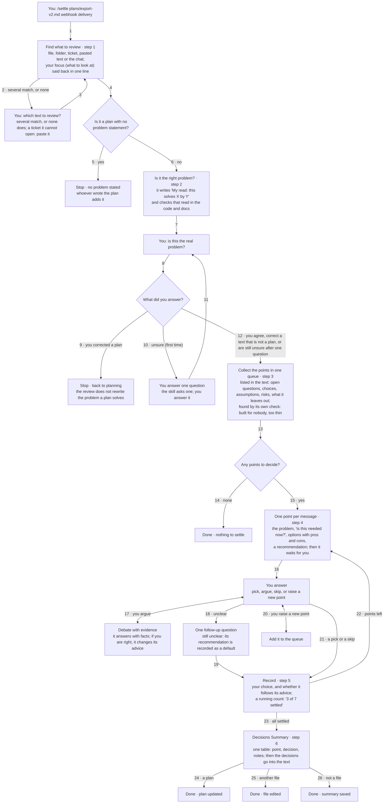

# settle

A Claude Code skill that goes through an existing plan, ticket or doc with you, one open point at
a time. Each point comes with options, pros and cons and a recommendation; your answers are
recorded and applied to the text at the end.

**Navigation**

- [The problem it solves](#the-problem-it-solves)
- [When to use it](#when-to-use-it)
- [When not to use it](#when-not-to-use-it)
- [How it works](#how-it-works)
- [Where the points come from](#where-the-points-come-from)
- [What a point looks like](#what-a-point-looks-like)
- [What you are asked](#what-you-are-asked)
- [Who does what](#who-does-what)
- [What makes it different](#what-makes-it-different)
- [Where the skill is](#where-the-skill-is)

## The problem it solves

You have a plan draft with open questions in it, and you ask Claude to "go through the plan and
resolve the open points". A tidier plan comes back. Some of the choices in it were yours to make,
and you never saw them. The skill is built against six ways such a pass can go wrong:

- **It decides for you.** The session picks an option for each open question and edits the plan.
  The choices that were yours are made without you.
- **It agrees with whoever spoke last.** It follows the plan's own wording, or your lean, instead
  of the code and the docs. The skill treats silent agreement as the failure.
- **It sees only the questions the plan lists.** A part built for no current user, or a part far
  too thin where the risk is real, stays in because nobody marked it open.
- **Ten points arrive in one message.** You answer the first three and skim the rest, and the rest
  are settled by default.
- **It solves the wrong problem well.** Every point gets a careful answer, but the plan was aimed
  at the wrong problem from the start.
- **The decisions stay in the chat.** The plan still shows the old options as open, and the next
  session argues them again.

settle checks the framing first, adds an audit to the plan's own list of questions, puts every
point to you one by one with a recommendation it argues for, and writes the decisions back into the
text.

## When to use it

- A plan, ticket, doc or config with open points that only you can decide.
- A draft that Claude or a colleague wrote, before anyone builds it: the audit finds what it
  builds for no one and what it leaves too thin.
- Open questions that piled up in the current chat ("walk me through the open points").

## When not to use it

| The case | Do instead |
| --- | --- |
| Nothing is written yet; you need the requirements first | A requirements interview, one question per message. settle reviews what exists. |
| You want agents to critique and fix the text without you deciding each point | [debate-loop](../debate-loop/README.md). Its reviewers are agents; here the decisions are yours. |
| You need the plan written, not reviewed | Write the implementation plan first, then settle it. |
| You need the reviewed change built | A build loop that runs the project's tests. settle edits the text, not the code. |
| You want to know whether it can be broken or abused | An adversarial (red team) review. |
| You want a one-shot review of written code | The project's own code review command, where it has one. |

## How it works

You run `/settle plans/export-v2.md webhook delivery`: the file is the subject, the words after it
are the focus. The diagram follows the skill's own steps (1 to 6); each arrow has a number, and the
list under it says what happens on that arrow.



### Arrow by arrow

**Find the subject**

1. You start the run with the subject (the text to review) and, if you want, a focus (the part of
   it to look at). A path, a folder, a ticket key or quoted text is the subject; the rest of your
   words are the focus. With no subject named, the subject is whatever the chat was just about,
   and all your words are the focus. The skill first reads a settings file the project may keep
   for this skill (where plans live, which docs count as the authority); without one, it reads the
   project's instruction files, such as `CLAUDE.md`.
2. Several plans match, nothing matches, or the ticket system cannot be reached: the skill asks you
   once, in the chat, never in a pop-up choice dialog. For a missing ticket it asks you to paste the
   ticket text.
3. Your answer names the subject. For a folder (one text split into several files), the skill
   reads every file in it, not only the index file that lists them.
4. The subject is found. The skill restates the focus in one sentence, so you can correct it. The
   focus narrows the review; it never moves it somewhere else.

**Check the framing**

5. Before any single point, the skill checks the framing: that the text solves the right problem,
   because a good answer to the wrong question is worse than an open one. First, a plan has to open with a
   problem statement: the current state, the problem, the end state and why it matters. Without
   one the review stops and names what is missing; the plan's writer (a skill that writes
   implementation plans, or the person) adds it first.
6. Not a plan, or a plan with its problem statement. Any other text with no stated goal is not a
   stop: the missing goal becomes Point 1.
7. The skill writes its reading ("My read: this adds CSV and JSON export by a new export job,
   aiming at reports users can download") and checks the claims in it: "there is no X today" gets
   a search of the code, a clash with a documented rule gets cited. If it finds nothing, it says
   what it checked.
8. The skill asks you: "Is this the actual problem you want solved?" and waits.
9. You correct the framing of a plan: the review stops, sums up the mismatch and sends the plan
   back to be planned again.
10. You are not sure, for the first time: the skill asks one focused question.
11. You answer it, and your answer goes through the same choice again.
12. You confirm; or you correct the framing of a text that is not a plan, and the corrected framing
    becomes the new subject statement; or you are still unsure after one question, and the
    unclear part becomes Point 1, with later points marked as maybe needing a second look. If the
    skill still thinks the framing is wrong after you confirm, it says so with evidence and you
    decide.

**Collect the points**

13. The skill reads the whole subject and collects two kinds of points. Listed points are the
    text's own open questions, the choices it made, its assumptions, the risks it accepts and what
    it leaves out. Audit points are what the text did not flag: parts built for no current user, a
    setting for a path with one implementation, a wrapper that only passes calls on, a feature
    "for later", and the opposite, a part too thin where the risk is real (error handling, data
    integrity, migration order). With a focus, only points tied to it stay; a point outside it
    stays only if it is critical (data loss, security, a broken architecture rule). If the focus
    names a list already in the chat, that list is the queue as it is, and the audit is skipped
    unless you ask. Everything goes into one numbered queue, with the total and where each point
    came from.
14. The queue is empty: the skill says "ready for implementation" for a plan, otherwise "no open
    decision points found", and stops.
15. There are points: the loop starts at Point 1.

**One point at a time**

16. One point per message, never several, never skipped. Each point has its source, the problem
    in words you understand without the text open, "Is this needed now?", two or more real
    options with pros and cons (or, when only one answer makes sense, a request to confirm it),
    and the skill's recommendation with its reason. When the answer to "Is this needed now?" is no
    or partly, "Defer with marker" is one of the options: nothing is built now, and a `# FUTURE:`
    comment is left where a later builder would look, saying what would make the need real, where
    the fix goes and how. Then the skill stops and waits. See [What a point looks like](#what-a-point-looks-like).
17. You argue against the recommendation. The skill answers with concrete counter-evidence (an
    edge case, a project rule, a pattern in the code) and does not give in on the first push. If
    you show something it missed, it says so and revises: "You're right, I missed X. Revised
    recommendation: B." After one or two rounds of argument, both positions are stated and you
    make the call.
18. Your answer is unclear: the skill asks one focused follow-up.
19. A clear answer is recorded. Still unclear: the skill's recommendation stands and is recorded
    as a default, not as your choice.
20. A new concern comes up mid-review: it goes to the end of the queue, the new total is
    announced, and the current point is finished first.
21. You pick an option, or say "skip". A skip is recorded as "Skipped by user", with no more
    arguing. A point deferred with a marker gets its marker confirmed before the loop moves on:
    the trigger, the place in the code, the approach.
22. The skill confirms in one sentence and keeps a running count: "Resolved: Option B, over my
    recommendation A (3 of 7)." It records the option, who recommended it, and whether a debate
    changed anything. Points remain: the next one comes straight away.

**Apply**

23. Every point is settled: the skill shows the Decisions Summary, one row per point with the
    decision and a note (followed the recommendation, you overrode it and why, deferred with a
    marker and where, or skipped).
24. A plan is updated by an agent that updates plans, if the project has one, else by the session, with
    small, exact edits: each open question is closed, rejected over-building is removed with every
    mention of it, options are marked Selected or Rejected alternative (the rejected ones keep
    their cons, because they explain why), thin parts are expanded, each deferral goes into a
    "Future Hooks / Deferred Features" section, and every section that mentions a changed part is
    updated. Untouched sections stay word for word. The skill then lists the markers the builder
    must place.
25. Any other file gets the same careful edits.
26. The subject is not a file (a ticket, pasted text or the chat's own open questions): the
    Decisions Summary is saved as a file in the project's folder for working notes (a scratch
    folder when there is none), so the record outlives the session.

## Where the points come from

The skill reads the whole subject and puts two kinds of points into one numbered queue. It says
which came from the text and which from its audit.

| Kind | What it looks for | Example |
| --- | --- | --- |
| Listed | The text's own open questions | "Open question: CSV only, or JSON too?" |
| Listed | Choices it made between approaches | The plan picked a nightly job over an on-demand export. You still confirm it. |
| Listed | Assumptions that could be wrong | "Reports never exceed 10,000 rows." |
| Listed | Risks it accepts, and what it leaves out | "No export for archived reports." |
| Audit: over-built | A class, interface or registry with no current user; a structure with one entry; a setting for a path with one implementation; a wrapper that only passes calls on; a feature "for later"; a shared helper bent with flags to fit one case | A persistent retry queue whose only consumer already retries once. |
| Audit: too thin | Error handling, concurrency, data integrity, migration order or backward compatibility left vague where the risk is real | "Migrate the table" with no word on what runs while the old and new columns both exist. |

An audit point comes with ready options: remove it, keep the simple version now and defer the
rest with a marker, expand it (for a thin part), or keep it as it is if it passes the project's
own rules on abstractions.

## What a point looks like

Every point is one chat message with the same parts, in this order:

| Part | What it holds |
| --- | --- |
| Source | Where the point came from: the text's own open question, a design choice, an assumption, or an audit finding (over-engineering or under-specification). |
| Problem | The decision in words you can follow without the text open, with the file, function and line it is about. |
| Is this needed now? | Yes, no or partly, with a reason in one or two sentences. |
| Options | Two or more real options, each with concrete pros and cons. "Defer with marker" must be one of them when the answer above is no or partly. A point with only one sensible answer is put to you as a question to confirm, with no invented options. |
| My recommendation | One option, with a reason tied to this project's code and rules. When the evidence is missing, the skill says what it would need instead of guessing. |

An example (the plan, paths and numbers are invented):

> **Point 2 of 4: Retry queue for the export webhook**
>
> **Source:** Audit finding, speculative feature
>
> **Problem:** The plan `plans/export-v2.md` adds a persistent retry queue to
> `exports/webhook.py:deliver`, with its own table and a worker. The only consumer is the nightly
> report job, and its caller already retries once and logs a failure (`reports/nightly.py:112`).
> No requirement asks for at-least-once delivery.
>
> **Is this needed now?** No. The report job runs again the next night, and the log shows a
> failed send.
>
> **Option A: Build the queue.** A retry table, a worker that drains it every minute, a dead-letter
> state after five tries. Pros: a delivery survives a crash. Cons: a second delivery path and a new
> worker for no current consumer; the plan grows by about a third.
>
> **Option B: Keep the single retry and log the loss.** Pros: no new parts; the loss shows in the
> log. Cons: a crash between the two tries loses that night's webhook.
>
> **Option C: Defer with marker.** Keep B now and leave a marker in `exports/webhook.py:deliver`.
> Pros: no dead code now; the pickup is cheap when the trigger fires. Cons: the marker helps only if
> someone reads it.
>
> **My recommendation:** Option C. B's loss costs one night's report, which runs again anyway, and
> the plan's own principle is "no machinery without a current caller".

The marker in option C is a comment at the place a future builder would look:

```
# FUTURE: persistent retry queue for webhook delivery
# Trigger: a second consumer appears, or a requirement asks for at-least-once delivery
# Fix location: exports/webhook.py:deliver
# Approach: an outbox row per delivery, drained by the existing worker; keep deliver() idempotent
```

After your answer the skill confirms in one line: "Resolved: Option C, following my
recommendation (2 of 4)." At the end the same point is one row of the Decisions Summary:

| # | Point | Decision | Notes |
| --- | --- | --- | --- |
| 2 | Retry queue for the export webhook | Deferred with marker | Marker at `exports/webhook.py:deliver`; trigger: a second consumer or an at-least-once requirement |

## What you are asked

Every question is a normal chat message you read in full, never a pop-up dialog with short option
labels: those labels cannot hold the problem, the pros and cons and the recommendation. You are
asked:

- **Which subject**, when several match or none does. Example: "Two plans match: the export plan
  and the import plan. Which one?"
- **Whether the framing is right**, once, before any point: "My read: this adds CSV and JSON export
  by a new export job, aiming at reports users can download. Is this the actual problem you want
  solved?"
- **Each point**, one per message, as in the example above. You can pick, argue, skip, or raise a
  new concern.
- **One follow-up**, when your answer is unclear. If it is still unclear, the recommendation is
  recorded as a default.
- **The marker's content**, when you choose to defer: the trigger, the place and the approach.
- **The final call**, when you and the skill still disagree after one or two rounds of argument.
  Your choice is recorded next to its recommendation.

## Who does what

| Role | What it does | What it may not do |
| --- | --- | --- |
| Main session (your Claude Code conversation) | Finds the subject, checks the framing, reads the code to check every claim, presents the points, argues, records, writes the summary and applies the decisions | Decide a point for you, skip a point, put several points in one message, or agree just to avoid friction |
| An agent that updates plans (only if the project has one) | Applies the decisions to a plan, given the path, the decisions and the update rules | Change sections the decisions do not touch |
| You | Confirm the framing, decide every point, make the final call in a disagreement | Nothing: every decision is yours |

## What makes it different

| Choice | Why |
| --- | --- |
| The framing is checked before any point | A well-executed answer to the wrong question is worse than an open one. |
| An audit adds points the text never flagged | The text can be wrong in either direction: built for needs nobody has, or too thin where the risk is real. |
| It pushes back on the text and on you | Silent agreement is the failure mode. The skill changes its view only on evidence, and says so when it does. |
| It reads the code before it recommends | A persuasive summary is not evidence. "We have no X today" gets a search, not a nod. |
| "I need X to recommend" is a valid answer | A clear statement of what is missing is stronger than a guessed option. |
| One point per message, none skipped | Every point gets a real look, and no ambiguity is left unresolved. |
| Questions in the chat, never in a dialog | A dialog's short option labels cannot hold the problem, the pros and cons and the recommendation. |
| "Defer with marker" is a full option | No dead code now, and the pickup is cheap when the trigger fires. |
| Rejected options keep their cons in the plan | They explain why the choice was made, for the next reader. |
| Decisions are written back, or saved as a file | The record must not die with the session; a disagreement stays visible later. |

## Where the skill is

The skill itself is not published in this repository. This page describes its design, so you can
build a review of your own or judge whether one would help you.
