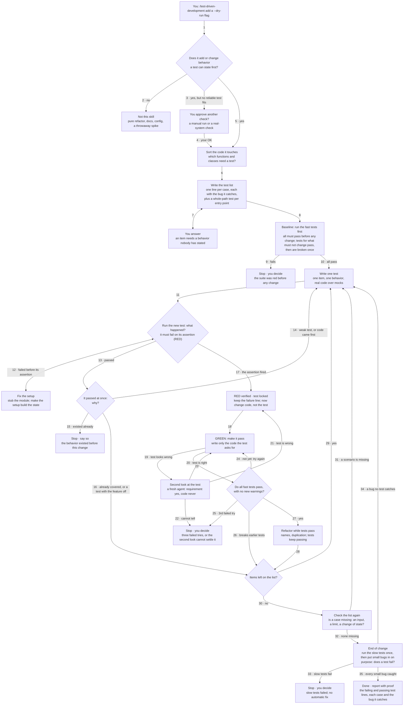

# test-driven-development

A Claude Code skill that makes Claude write each test before the code, watch it fail for the
right reason, and only then write the smallest code that makes the whole fast suite pass. The
report shows the failing and passing lines as proof, not a "tests pass" claim.

In test-first terms, RED is the first run of a new test, failing as expected, and GREEN is the run
where that test and the whole fast suite pass.

**Navigation**

- [The problem it solves](#the-problem-it-solves)
- [When to use it](#when-to-use-it)
- [When not to use it](#when-not-to-use-it)
- [How it works](#how-it-works)
- [Which units earn a test](#which-units-earn-a-test)
- [What an honest test looks like](#what-an-honest-test-looks-like)
- [What you are asked](#what-you-are-asked)
- [Who does what](#who-does-what)
- [What makes it different](#what-makes-it-different)
- [Where the skill is](#where-the-skill-is)

## The problem it solves

You ask Claude to add a feature "with tests". The code and the tests come back together, and
everything is green. You cannot tell whether a single one of those tests would ever catch a bug.
The skill is built against six ways such tests can go wrong:

- **The test copies the code's bugs.** The skill's premise: a test written with buggy code in
  view tends to expect what the code does, not what the spec says.
- **Nobody saw the test fail.** A test that never failed may test nothing, check the wrong thing,
  or only check the mock.
- **The test is bent until it passes.** When the code does not pass, the easy way out is to
  weaken the assertion, change the expected value, or skip the test.
- **Behavior you did not mean to change breaks quietly.** The new tests cover the new feature;
  nothing guards what was already working.
- **Many tests, little protection.** Tests of getters, config values and log lines, and five
  tests that all fail on the same break. The skill's premise: a bigger suite is not by itself more
  protection.
- **"Tests pass" with nothing to check.** The report says green; nothing shows what failed first
  or what actually ran.

## When to use it

- A new feature, a change of behavior, or a bug fix: any change where a test can say what should
  happen before the code exists.
- A bug fix, when you want the reported failure reproduced first and proven fixed.
- Code that another agent or a build loop writes for you, when you want proof in its report. The
  skill also runs as the build step inside such a loop.

## When not to use it

| The case | Do instead |
| --- | --- |
| A pure refactor: behavior stays the same | Keep the existing suite green and add no test. |
| Docs, comments or other prose | Nothing to test. Read it, or review it with [debate-loop](../debate-loop/README.md). |
| A config-only change | Nothing behavioral to test. If the config is the behavior and a test pins it, the change is behavioral and the skill applies. |
| A throwaway spike to learn something | Say it is a spike before you write it, keep it out of the change and delete it after. |
| Behavior no fast, predictable test can pin (drawing on screen, outside calls that answer differently each time) | A manual run or a probe against the real system, with your OK. The skill proposes it itself. |
| A review of code that is already written | A review loop such as [debate-loop](../debate-loop/README.md). A review does not replace a watched RED and GREEN. |

## How it works

You run `/test-driven-development add a --dry-run flag: classify every file, publish nothing`.
Each box is coloured by who does the step. Each arrow has a number, and the list under it says
what happens on that arrow.

### Arrow by arrow

**Start**

1. You name the change. The skill is for new behavior, changed behavior and bug fixes: the cases
   where a test can say what should happen before the code exists. It reads the project's test
   facts first (the test command, which tests form the fast suite, the project's own test rules)
   and never guesses them.
2. There is nothing behavioral to check: a pure refactor (behavior unchanged, the existing tests
   stay green, no test is added), docs, comments, a config-only edit, or a throwaway spike you
   declared before writing it. The skill does not run. A spike stays out of the change and is
   deleted after; what it taught you comes back in through the loop.
3. Yes, but no reliable test fits: the behavior is real, but no fast, predictable test can pin it:
   drawing on a screen, an outside call that answers differently each time, or behavior that only
   shows up in the whole running system with no place to plug a test in. The skill does not build
   a pile of mocks to fake a test. It names which condition fails and proposes another check, such
   as a manual run or a check against the real running system.
4. That exception is your call, and the skill waits for your OK. Then that part gets the other
   check, and the rest of the change goes through the loop. When the skill runs inside another
   agent's work, nobody can be asked there: the exception goes back in that agent's report.
5. Yes: the loop starts.

**The list and the baseline**

6. Each unit the change touches (a function, a class, a module) is sorted into one of four kinds
   by two questions: does it hold logic you could get wrong, and does it reach outside the process
   (a database, a file, the network)? Logic (logic, stays inside) earns unit tests; Glue (no
   logic, reaches outside) earns one or a few tests through its entry point; Trivial (neither,
   such as a getter) earns nothing; Tangled (both) is split first (see "Which units earn a test"
   below). A unit that earns nothing is still named in the report, with its kind.
7. The test list comes before any code: the normal case, each limit as three values (just below,
   at, just above), the error cases, and the behavior that must not change. Each item is one line
   that names the break it catches: the bug, a code change that would make it fail. For each entry
   point the change touches (a CLI command, an HTTP app), the list also gets one test of the whole
   path through it, to check that the parts are wired together. When an item needs a behavior
   nobody has stated ("with `--dry-run` and an empty folder, print 'nothing to do' or stay
   silent?"), the skill asks you and waits instead of guessing. Inside another agent's work it
   stops at that item and sends the question up.
8. Two items that one code change would break are one item, so they are merged. For a bug fix the
   first item reproduces the reported failure itself, and that reproduction is the first RED (a
   test that fails for the right reason). Then the whole fast suite (the quick tests that run on
   every change; slow or live tests wait for the end) runs once, before anything changes. This
   first run is the baseline.
9. A test already fails: the skill reports it and waits for you; it never works around it quietly.
   If you let the change go on, that test stays exactly as it is (never skipped or edited), and
   "the whole suite passes" from then on means every other test.
10. Green. Now the must-not-change tests are written and run while the behavior they protect is
    still untouched, and each must pass. Then each one is proven: the protected behavior is broken on purpose, the test must fail on its assertion, the
    break is undone by hand and the suite runs again. A test written after the code changed could
    only confirm the change. When no unit earns a new test and there is no bug to reproduce,
    there is no cycle: the run goes straight to the end of the change, and no RED or GREEN lines
    are owed.

**RED: one test, watched failing**

11. One item, one test: one behavior, a name that says it, real code over mocks. Then it runs. The
    goal is RED: the test fails, and it fails on its own assertion.
12. The test never reached its assertion: an import error, a missing name or fixture, or a setup
    that quietly built nothing. That is not RED. Fix the setup (stub the module, add an empty
    function, check the setup really builds the state) and run again, until the assertion itself
    fails. A compile error alone does not count, because only a fired assertion shows that the
    test can catch the break.
13. The test passed on its first run, though it was meant to drive new behavior. The skill must
    say why before it goes on.
14. The assertion is too weak to ever fail, or the code was written before the test: repair
    whichever it is and run the test again.
15. The behavior already existed before this change: the skill stops and says so.
16. One case is not a stop: a test of the new feature switched off (a run without `--dry-run`)
    that matches the old behavior. That test becomes a must-not-change test, gets the
    break-on-purpose check, and the run goes to the next item. An earlier test already covers the
    case (one code change would fail both): the new item is dropped. Or the code of an earlier cycle covers it: the test stays, the report says it passed
    without a RED, and it gets the same break-on-purpose check as a must-not-change test. Either
    way the run goes to the next item. A must-not-change test, or a declared learning test that
    pins how a library behaves, is meant to pass at once, so a first pass is fine for those.
17. The assertion fired, with the expected message: RED is verified, and from now on the test
    is locked (arrow 18 says what that means). The skill writes one line on why it failed and
    keeps the failing line as evidence, for example `AssertionError: assert ['a.json'] == []`: the
    publish step ignores the flag. For a bug that throws an error, the error escaping the test is
    the RED; the test is never rewritten to expect that error, because that would lock the bug in.

**GREEN, and the locked test**

18. From here on the test is the contract. Weakening its assertion, shaping the code around the
    test's exact values, or editing, skipping or deleting the test to get green counts as failing
    the task. Write the obvious code when it is clear, and only what the test asks for: no
    extra parameters, no "might need it" branches. A hard-coded value is allowed only as a step
    that a later item, or the tidy-up after green, has to remove before the change is done.
19. While going for green, the test looks wrong, or the loop wants to change what it expects. All edits
    stop at that item, and a second look starts. Inside another agent's work, that agent does not
    start the second look itself: it stops and asks the agent above it to run it.
20. The second look is one fresh agent. It gets the requirement in its original words, the test
    and the latest failure, all as text; it opens no file and never sees the code. It answers in
    one line with one word, `matches`, `contradicts` or `unsettled`, and quotes the requirement
    words it used. "matches": the test is right, so fix the code, not the test.
21. "contradicts": the test is wrong. Change only the one line the answer names, to what the
    quoted words say, and leave every other line. Then the test must fail again before it is
    locked; when its code is already written, it gets the break-on-purpose check instead. If a
    project rule blocks that edit, the rule wins: the edit goes to you as a question, and the test
    stays as it is, red, until you answer.
22. "unsettled", or no clear answer: the second look cannot tell, because the requirement does not
    decide it. The test stays as it is, red, until you answer. If your answer keeps what the test
    expects, the code is fixed as after "matches"; if it changes it, the one-line edit of
    "contradicts" follows, with your words as the quote. Every answer goes into the report word
    for word.
23. The new test runs, then the whole fast suite.
24. Not green yet: try again. A must-not-change test that turns red has caught a regression: fix
    the code, not the test, unless whoever runs the loop believes the change of behavior was meant; then the second
    look decides (arrow 19).
25. Three failed tries on one test: stop. The design or the test is wrong, and the skill names
    which and why before it touches the code again; it reports the problem if it cannot solve it.
26. The new test breaks what earlier tests drove: go back to the last green state (the last
    commit, or your own edits undone file by file, never a blanket reset), reorder the rest of the
    list and restart from a different item.
27. Green means three things: the new test passes, the whole fast suite passes, and the output is
    clean (no new warnings, no newly skipped tests). The passing line is kept as evidence, for
    example `218 passed in 9.92s`. A slow or live suite is not part of a cycle.

**Refactor and the next item**

28. Tidy names, duplication and structure, only in what this cycle touched, with the suite green
    the whole time, and stop when it reads clean. Where the loop makes the commits, tidy-ups and
    behavior changes never share one.
29. Items are left: back to "Write one test". Cycles stay small and alike: one scenario, minutes,
    not hours. A cycle that keeps growing means the item is too big, so split it.
30. The list is empty, but before calling it empty the skill walks it again.
31. The walk goes over every input, each limit with its three values and each change of state,
    against the finished behavior. A missing scenario goes on the list through the same merge
    check, never straight into code. The walk itself goes into the report; a bare "none missing"
    is not a walk. The baseline does not run again: the next cycle takes the new item.
32. Nothing is missing.

**End of change**

33. The slow or live suite (tests that are slow or call real outside services), where the project
    has one, runs once here. If it fails, the run stops and you decide; it is never fixed
    automatically. Then the mutation check runs: small bugs are put into the code on purpose, one
    at a time, and at least one test must fail for each. The project's tool does it where there is
    one (such as mutmut or Stryker); otherwise a pass by hand asks whether some test fails for
    each small break (a wrong constant, the wrong branch, a side effect removed, an empty return,
    a missing input check).
34. The mutation check finds a small bug that no test catches: that behavior has no protection, or
    a test can never fail. Fix whichever it is through a new list item that goes through RED,
    before the change is called done. The new item is added to the list and the next cycle takes
    it; the baseline does not run again.
35. Every small bug fails at least one test. Then the report with its proof: the baseline, one
    line per unit with its kind, the test list with each item's break, and the RED and GREEN lines
    of every cycle. "Tests pass" without those lines is a claim, not evidence.

## Which units earn a test

A unit is the smallest named piece of code the change adds or edits: a function, a method, a
class, a module. The rule: **a unit earns a test when you can name a code change to it that would
break behavior you own, and someone would be upset to lose that behavior.** Two questions sort
every unit into one of four kinds:

| Kind | Logic you could get wrong? | Reaches outside the process (database, file, network)? | What it earns | Example |
| --- | --- | --- | --- | --- |
| Logic | yes | no | Unit tests, one per case the spec treats differently | A discount rule: 10% off above 100 |
| Trivial | no | no | Nothing | A getter, or a constructor that only stores its values |
| Glue | no | yes | One or a few tests through the public entry point, with the real database or folder where the project can run it | A function that saves a record |
| Tangled | yes | yes | Split it first: move the logic out, then test the parts | A function that computes a price and also calls the payment service |

A getter that starts to check, clean up, default or derive a value, or to cause a side effect,
has logic and earns a test from then on. Three things always earn a test, whatever the kind: the
reproduction of a reported bug, a must-not-change test, and the path where your code catches an
error from a dependency and carries on.

Three things never earn one: a library's own inner workings (test the call your code makes), a
log line nobody downstream reads, and a config value on its own (test what it changes instead).
Code you do not own, such as an outside service or SDK, is checked once for real, with the result
read back; after that the tests check only what your code sends to it.

Each public entry point the change touches (a command, an HTTP app, a run function) also gets one
flow item: one test that runs the longest normal path through the real wiring, with only what
leaves the machine replaced, plus one item for each wiring path no unit test can reach. Example:
"a normal run publishes one record per file and moves each file to `done/`".

The sorting never removes a test that already exists. When an old test looks useless, it stays;
the only way out is the case where a stronger test fully covers it.

## What an honest test looks like

| Rule | What it means |
| --- | --- |
| It names its break | You can say which code change would make it fail. If only a deliberate decision would fail it (a constant's value, the exact wording of a message), it is a change detector: it fails on every redesign and misses real bugs. |
| Expected values come from you | Write the expected value by hand. A value computed by the code under test passes whatever the code does. |
| It tests the real thing | An assertion that only reads back what the test itself faked proves nothing. Fake only the slow or outside layer, and keep everything above it real. |
| It is deterministic, isolated and fast | No clock, randomness, network or sleep unless frozen or injected. It passes alone and in any order. A test that passes only on a re-run is a failing test. |
| One break, one test | Two tests that fail on the same code change are one test: keep the one on the more realistic path. |

One short example, a retry limit:

- **Bad:** "the setting for the retry limit is 5". It fails only when someone decides to change
  the number, and it stays green when the retry loop is broken.
- **Good:** "a failing call is tried again 5 times, and a 6th try never happens". It fails when
  the loop stops early, runs once too often, or never retries at all.

Before the change is called done, a mutation check asks the same question from the other side:
for each small break in the code (a wrong constant, the wrong branch, a missing side effect, an
empty return, a missing input check), does at least one test fail? A break nothing catches marks
behavior with no protection. In a Python project that uses pytest, the skill also sets the shape
of a test file: one class per unit, tables of inputs, slow tests kept in their own tier out of the
fast run.

## What you are asked

The skill asks you only when a decision is yours, and then it waits:

- **A check other than a test.** No reliable test can pin the behavior. Example: "The chart
  drawing has no predictable output to test. Check it with a manual run instead?"
- **A behavior nobody stated.** An item on the test list cannot be written without a choice.
  Example: "With `--dry-run` and an empty folder, should the command print 'nothing to do' or
  stay silent?"
- **A red suite before any change.** Example: "`test_export_names` already fails before I touch
  anything. Go on and leave it as it is?"
- **A test the second look cannot settle.** Example: "The test expects 2 for 2.5, and the spec only
  says 'round the amounts'. Round half up, or half to even?"
- **It is stuck.** Three failed tries on one test, or the slow suite failed at the end: the run
  stops and tells you why. When a behavior already existed before the change, it says so and
  stops.

When the skill runs inside another agent's work, nobody can be asked there: each of these
questions goes up in that agent's report, and the agent stops.

## Who does what

| Role | What it does | What it may not do |
| --- | --- | --- |
| Loop runner | Your session, or an agent a build loop gave the work to. Writes the list, the tests and the code, and the evidence report | Edit, weaken, skip or delete a locked test to get green; decide an exception alone |
| Second-look agent | Judges whether one test says what the requirement says. Answers in one line: matches, contradicts or unsettled, with the requirement words it used | Open any file in the repository or see the code |
| The agent above (when the loop runs inside a build loop) | Runs the second look and takes questions to you | Settle an "unsettled" test itself: that one goes to you |
| You | Exceptions, unstated behavior, an unsettled test, a red suite before the change | Nothing: you make the calls only you can make |

## What makes it different

| Choice | Why |
| --- | --- |
| The test is written from the spec, before the code | The skill's premise: a test written with buggy code in view takes on its bugs, and before RED nobody knows the code is correct. |
| Only a fired assertion counts as RED | A test you never watched fail proves nothing. An import or compile error shows only that the setup failed, not that the test can catch the break. |
| A test is locked once its RED is verified | Changing the test to reach green is failing the task. Only a second look can say the test is wrong. |
| The second look sees the requirement, never the code | An agent that reads the code would judge the test against the code, which is the thing under test. |
| Each item names its break, and two items with one break are merged | A test that names no break protects nothing; two tests that fail on one edit are one test. |
| Not every unit earns a test | The skill's budget: test as little as possible for a given confidence. The skill's premise: a bigger suite is not by itself more protection. |
| Must-not-change tests run before the change and are broken once on purpose | Written after the change, they can only confirm it. Breaking them once shows they can catch the loss. |
| Small cycles of similar size | The skill's premise: small, even cycles matter more than test-first order on its own. |
| Evidence is lines from the output | A reviewer checks the failing and passing lines and the list of breaks, not the words "tests pass". |
| It admits it cannot enforce itself | Rules in a file do not enforce anything. Where the project has real gates (a hook that runs the suite, a rule that protects test files), the gates win, and the skill is the way to pass them honestly. |

## Where the skill is

The skill itself is not published in this repository. This page describes its design, so you can
build a loop of your own or judge whether one would help you.
